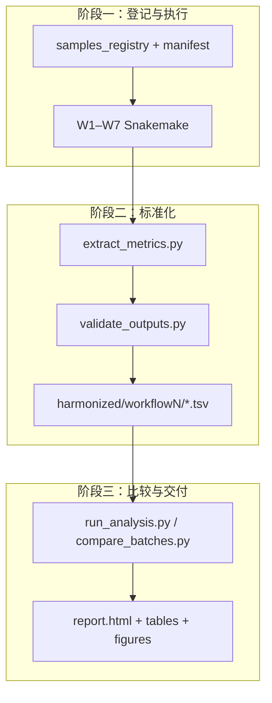
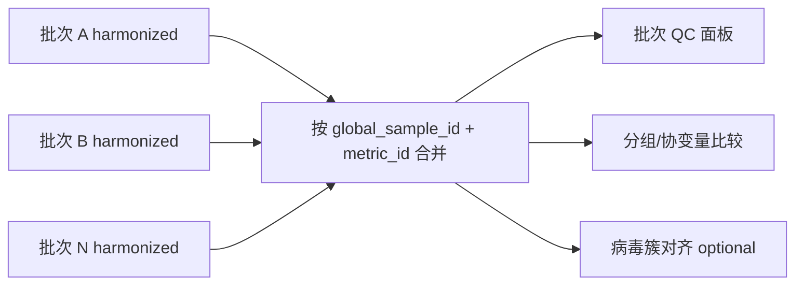

# XvirBench：面向宏转录组的跨批次统一指标框架与可比较分析体系

## 分析规划书

| 项目 | 内容 |
| --- | --- |
| **研究题目** | XvirBench：面向宏转录组的跨批次统一指标框架与可比较分析体系 |
| **英文题目** | XvirBench: A harmonized metrics framework for cross-batch comparative analysis of metatranscriptomes |
| **文档版本** | v1.1 |
| **编制日期** | 2026-05-26 |
| **指标字典** | [`docs/WORKFLOW_SUMMARY.md`](docs/WORKFLOW_SUMMARY.md) |
| **框架设计** | [`docs/DESIGN.md`](docs/DESIGN.md) |
| **目录规范** | [`docs/DIR.md`](docs/DIR.md) |
| **流程规范** | [`../Workflows/STANDARDS.md`](../Workflows/STANDARDS.md)（Workflows 仓库） |
| **主批次** | [`batches/vazyme_fragment_test/`](batches/vazyme_fragment_test/)（60 样本，V350399508） |
| **历史计算目录** | `Workflows/benchmark/test/runs/pxy_V350399508/`（经 `legacy_run_dir` 引用） |
| **仓库根目录** | `/data/user/guojindan/Projects/XvirBench` |

---

## 摘要

宏转录组测序在病毒监测、病原体发现和微生物群落研究中应用广泛，但不同项目、批次与实验设计下的生信流程输出格式各异，缺乏统一的指标空间与元数据登记规范，导致**跨队列比较困难、结果难以复现与整合**。本研究拟构建 **XvirBench** 分析体系：在既有七条 Snakemake Workflow（W1–W7）执行层之上，建立**元数据登记、指标标准化抽取、harmonized 存储与比较分析**四层架构，使**任意一组宏转录数据**在登记后均可映射到同一套指标维度，支撑批次间 QC、分组比较与方法学 benchmark。

本规划书以主批次 **vazyme_fragment_test**（60 样本 v61–v120、240 run、W1–W5/W7 已完成）为当前验证基础，说明研究背景、目标、内容、技术路线与预期成果。测序批次标签 V350399508 对应历史路径 `pxy_V350399508`（11 代表样本 QC 子集），已合并为同一项目，不再作为独立 XvirBench 批次。大鼠/蜱/蚊虫与三种建库打断方法为**首个完整验证场景**，不作为框架边界。

[《Workflows 七流程总结》](https://alidocs.dingtalk.com/i/nodes/R1zknDm0WR3dZDrofxd6o42nVBQEx5rG?utm_scene=team_space)

---

## 一、研究背景

### 1.1 领域现状与痛点

宏转录组（metatranscriptomics）可同时捕获宿主转录本、病毒 RNA 与细菌/真菌等微生物 RNA 信号，是 One Health 与病原监测的重要技术路线。实践中常见以下问题：

1.  **流程输出碎片化**：质控 JSON、组装 FASTA、BLAST 表、Bracken 丰度、RPM 矩阵、Excel 宿主鉴定表等分散在不同目录，字段命名与粒度不统一。
    
2.  **跨批次不可比**：不同批次的样本 ID、病毒参考序列、Kraken/CheckV 数据库版本、软件版本未系统登记；比较时往往只能做「目视对比」或手工拼表。
    
3.  **指标语义不清**：如「病毒丰度」可能指 RPM、mapped reads 比例或 contig 数；「宿主信号」可能来自 W3 EukaMarker 或 W7 STAR 比对，缺少统一 ID。
    
4.  **实验因素与生物信号混杂**：建库方法、测序深度、宿主物种、批次效应等未在元数据层显式建模，组间比较易得出偏倚结论。
    
5.  **方法学评估缺乏基准**：RNA 热打断 vs cDNA 酶切等建库策略对**下游病毒/微生物检出**的影响，缺少与宿主 RNA-seq 质量指标（W7）联动的统一评估框架。
    

### 1.2 已有工作基础

本课题组已具备较完整的执行层与分析试点：

| 层次 | 已有成果 | 说明 |
| --- | --- | --- |
| **执行层** | W1–W7 共七条 Snakemake 流程 | W1 上游 → W2/W3/W4 并行 → W5/W6；W7 建库方法学 benchmark |
| **指标字典** | [`docs/WORKFLOW_SUMMARY.md`](docs/WORKFLOW_SUMMARY.md) | W1-R01…W7-F21 百余项可抽取指标及来源文件 |
| **框架设计** | [`docs/DESIGN.md`](docs/DESIGN.md) | manifest、registry、harmonized、比较层架构 |
| **目录规范** | [`docs/DIR.md`](docs/DIR.md) | XvirBench 一级/批次目录、软链约定 |
| **仓库结构** | `XvirBench/{batches,docs,scripts,comparisons}/` | 比较与编排层与 Workflows 执行层分离 |
| **指标抽取** | `scripts/extract_lib.py` + `extract_metrics.py` | 读 manifest + workflow 输出 → `harmonized/workflowN/*.tsv` |
| **分组比较** | `scripts/analysis/run_analysis.py` 等 | 读 cohorts + harmonized → `analysis/{tables,figures,report.html}` |
| **自动化运行** | `scripts/run_w1_to_w5.sh` | 批次 W1→W5 编排（legacy，指向 Workflows） |
| **主批次** | `vazyme_fragment_test` | 60 样本 × 三宿主 × 三建库方法；harmonized + HTML 报告已完成 |
| **关联项目** | `vazyme/fragmentation_test` | 按宿主 STAR/Picard 基准；W7 数值与 harmonized 一致 |

### 1.3 主批次简述（vazyme_fragment_test）

**vazyme_fragment_test** 为当前 XvirBench 唯一活跃批次，用于验证「登记 → 执行 → 抽取 → 比较」闭环：

* **规模**：240 测序 run → 60 生物学样本（v61–v120）；元数据 canonical 来源 `vazyme/sampleinfo.tsv`
* **分组变量**：`method`（cDNA_Frag_30C5Min / RNA_Frag_85C6Min / RNA_Frag_94C7Min）；`host`（rat / tick / mosquito）
* **流程完成度**：W1–W5、W7 全部 60/60（W6 未纳入）；详见 [`manifest.yaml`](batches/vazyme_fragment_test/manifest.yaml)
* **已产出**：
  * harmonized 表：`batches/vazyme_fragment_test/harmonized/workflow1/` … `workflow7/`
  * 分组比较 HTML：[`analysis/report.html`](batches/vazyme_fragment_test/analysis/report.html)（图表 base64 内嵌）
  * 结构化表/图：`analysis/tables/`、`analysis/figures/`、`analysis/text/*_interpretation.md`
* **历史报告**（11 代表样本 QC）：`analysis/reports/` → 软链至 `Workflows/.../pxy_V350399508/reports/`
* **已知 QC**：部分样本 R1 < 5M reads（如 v63、v73、v88–v90）；分析内置低深度 flag 与分宿主分层

该批次证明：**在统一 harmonized 指标下，可按 method × host 对 W1–W7 做分层组间比较**；W7 大鼠分层结果与 `vazyme/fragmentation_test/analysis/rat/` 一致。

### 1.4 历史试点（pxy 11 样本子集，已合并）

原 **pxy_V350399508**（11 代表样本、W1–W5）用于早期框架验证；计算数据仍位于 `Workflows/benchmark/test/runs/pxy_V350399508/`，通过 `legacy_run_dir` 引用，**不再**作为独立 `batches/pxy_V350399508/` 目录。

---

## 二、研究目标与意义

### 2.1 总体目标

构建 **XvirBench** 跨批次一体化分析体系，实现：

> **任意宏转录组批次在元数据登记与流程执行后，均可被抽取到同一指标空间，并在统一维度下进行 QC、分组比较与跨批次整合分析。**

### 2.2 具体目标

| 编号 | 目标 | 可验收标准 |
| --- | --- | --- |
| **G1** | 建立指标字典与数据模型 | 覆盖 W1–W7 全部 metric\_id；harmonized 长表/宽表 schema 定稿并入库 |
| **G2** | 建立元数据登记规范 | 每批次具备 `manifest.yaml` + `samples_registry.tsv`；含 batch/group/method/数据库版本 |
| **G3** | 实现指标自动抽取 | `extract_metrics.py` 对试点批次抽取成功率 >95%；`validate_outputs.py` 通过 |
| **G4** | 实现比较分析模块 | 支持组内/组间比较、批次间 QC 面板、低深度/异常样本 flag |
| **G5** | 完成主批次验证 | `vazyme_fragment_test` 60 样本 harmonized + HTML 报告可一键再生 |
| **G6** | 扩展第二批次 | 至少再接入 1 个批次，演示跨批次 `compare_batches.py` |
| **G7**（可选） | 病毒跨批次对齐 | `build_virus_cluster_map.py` + 统一参考策略 B 试点 |

### 2.3 科学意义

1.  **方法学**：为宏转录组病毒/微生物分析提供可复用的「指标—流程—文件」映射标准，降低跨项目整合成本。
    
2.  **应用**：支撑病原监测、暴发调查、建库方案选型（W7）等多场景在同一尺度下的比较。
    
3.  **可重复性**：manifest 锁定软件与数据库版本，指标带 `source_file` 与 `extracted_at`，满足审计与复现要求。
    

### 2.4 应用价值

*   **实验室内部**：新批次上线后自动进入同一 QC 看板，与历史批次对比深度、病毒检出与微生物背景。
    
*   **多中心协作**：通过 `global_sample_id` 与统一 metric\_id 合并队列，避免手工拼表错误。
    
*   **产品/服务交付**：标准化 Excel/Parquet 报告模板，缩短从测序到解读周期。
    

---

## 三、研究内容

研究内容分为 **五个模块**，与 XvirBench 架构一一对应。

### 3.1 模块 A：指标字典与可比性规则（理论层）

**依据**：[`docs/WORKFLOW_SUMMARY.md`](docs/WORKFLOW_SUMMARY.md)

*   维护 W1–W7 全部可获取指标的定义：指标 ID、名称、粒度（run/sample/contig/taxon）、来源文件、字段路径、单位。
    
*   定义**跨流程最小指标集**（测序深度、组装规模、病毒鉴定、病毒丰度、微生物背景、宿主背景、注释质量、建库方法学，见 WORKFLOW\_SUMMARY §跨流程核心衔接指标）。
    
*   制定**可比性规则**（DESIGN §5）：
    
    *   深度：RPM 分母、保留率、极差比 flag
        
    *   微生物：同一 Kraken 库版本；丰度用 fraction 或 CLR
        
    *   病毒：策略 A（簇级比较）vs 策略 B（统一参考重比对）
        
    *   W7：同一宿主参考 FASTA+GTF 版本
        

**产出**：`docs/schema/metrics_schema.yaml`（规划；指标 ID → 列定义、类型、单位）。

### 3.2 模块 B：元数据与批次登记（登记层）

**依据**：DESIGN §4

* **`cohorts/sampleinfo.tsv`**：样本 ID、宿主、建库方法、FASTQ/assembly 路径等（本批次软链至 `vazyme/sampleinfo.tsv`）
* **`cohorts/samples_registry.tsv`**：全局/本地样本 ID、run 列表、workflow 输出索引
* **`manifest.yaml`**：测序平台、各 workflow 状态与输出路径、`legacy_run_dir`、数据库版本
* **分组语义**：`method` 用于建库方法比较；`host` 用于分层；`sn`（测序文库）用于配对重复

**登记示例**：

```plaintext
sampleinfo id=61 → sample_id: v61
                 → method: cDNA_Frag_30C5Min
                 → host: rat
                 → global_sample_id: vazyme_fragment_test__v61
```

### 3.3 模块 C：流程执行与质量控制（执行层）

**依据**：W1–W7 Snakemake 流程 + `scripts/run_w1_to_w5.sh`

* 标准分析链：**W1 →（W2 ∥ W3 ∥ W4）→ W5 →（W6）**；W7 按宿主参考并行
* 批次结果目录：`batches/{batch_id}/workflow_results/`（**软链**至 Workflows 或 vazyme 实际输出，不复制大文件）
* 历史计算：`manifest.yaml` 中 `legacy_run_dir` 指向 `Workflows/benchmark/test/runs/pxy_V350399508/`
* QC 门禁：深度、Q30、保留率、低深度 flag

**vazyme_fragment_test 已验证**：W1/W3/W4 经 legacy 路径；W2/W5/W7 经 `vazyme/fragmentation_test` 按宿主分目录软链。

### 3.4 模块 D：指标抽取与 harmonized 存储（标准化层）

**依据**：DESIGN §6–§7

实现并完善：

| 脚本 | 功能 |
| --- | --- |
| `scripts/extract_lib.py` | 抽取核心库（路径解析、cohort 过滤、写表） |
| `scripts/extract_metrics.py` | CLI：`-w workflowN` 或 `--all` |
| `batches/{id}/scripts/extract.sh` | 批次快捷抽取 |
| `scripts/validate_outputs.py` | （规划）输出完整性、必填指标非空率 |
| `scripts/normalize_bracken.py` | （规划）Bracken 长表化 |
| `scripts/build_virus_cluster_map.py` | （规划）跨批次病毒 contig 簇映射 |

**Harmonized 当前实现**（TSV + JSON，按 workflow 分子目录）：

```
batches/{batch_id}/harmonized/
├── workflow1/   qc_upstream_{run,sample,summary}.tsv
├── workflow2/   virus_identification_{sample,contigs,clusters}.tsv
├── workflow3/   host_identification_{sample,contig}.tsv
├── workflow4/   microbiome_bracken_{sample,top15}.tsv
├── workflow5/   virus_quantification_{sample,rpm}.tsv
└── workflow7/   fragmentation_benchmark.tsv
```

Parquet 长表为后续目标；当前以 TSV 为主，可选写 `.parquet`（需 pyarrow）。

**过渡方案**：历史 `build_benchmark_report.py` → Excel 仍保留于 `analysis/reports/`；新流程以 harmonized TSV + `run_analysis.py` 为主。

### 3.5 模块 E：比较分析与报告（比较层）

**依据**：DESIGN §8 + `scripts/analysis/` 已实现模块

* **组内/组间比较**：按 `method`、`host` 分层；Kruskal-Wallis + Mann-Whitney（BH）；全队列 / 排除低深度 / 分宿主
* **批次间比较**：（规划）多批次 harmonized join → `comparisons/{comparison_id}/`
* **可视化**：多面板箱线图、分宿主 facet、热图、PCA；低深度红圈标注
* **报告**：`analysis/report.html`（RAT 风格侧边栏 + 图内嵌）；`analysis/text/*_interpretation.md`

| 脚本 | 功能 |
| --- | --- |
| `scripts/analysis/run_analysis.py` | 主入口：`--all` 或 `-w workflowN` |
| `scripts/analysis/analyze_workflows.py` | 各 workflow 指标合并与统计 |
| `scripts/analysis/module_plots.py` | 多面板图（对齐 vazyme 分析风格） |
| `scripts/analysis/build_html_report.py` | HTML 报告生成 |
| `batches/{id}/scripts/run_analysis.sh` | 批次快捷脚本 |

**比较配置示例**（规划，`comparisons/{id}/config.yaml`）：

```yaml
comparison_id: "vazyme_fragmentation_w1w7"
batches: ["vazyme_fragment_test"]
group_by: "method"
stratify_by: ["host"]
metrics: ["W1-S01", "W2-V01", "W4-K01", "W5-Q08", "W7-F01"]
exclude_flags: ["low_depth"]
tests: ["kruskal_wallis", "mannwhitney_bh"]
```
---

## 四、技术路线

### 4.1 总体架构



**设计原则**：执行与比较解耦；比较层只读 workflow 输出，不修改 Snakemake 规则（DESIGN §1.3）。

### 4.2 数据流（单批次）

```plaintext
原始 FASTQ + 样本表/分组表
    ↓ 登记 manifest + registry
W1 fastp → 去 rRNA → 合并 → 组装
    ↓                    ↓
clean reads + contigs   W1 指标 (W1-R*, W1-S*)
    ↓
W2 病毒鉴定 ∥ W3 宿主鉴定 ∥ W4 Kraken/Bracken
    ↓
W5 病毒 RPM 定量（参考 = 本批次 W2 putative_viralcontigs）
    ↓（可选 W6 注释、W7 建库 benchmark）
extract_metrics.py → harmonized/workflowN/*.tsv
    ↓
run_analysis.py → 统计 + 多面板图 + report.html

```

### 4.3 指标抽取路线（按 Workflow）

[《Workflows 七流程总结》](https://alidocs.dingtalk.com/i/nodes/R1zknDm0WR3dZDrofxd6o42nVBQEx5rG?utm_scene=team_space)

| Workflow | 核心抽取指标（metric\_id 示例） | vazyme\_fragment\_test 状态 |
| --- | --- | --- |
| W1 | W1-R01–R19（run QC）；W1-S01–S08（sample 组装） | ✅ harmonized/workflow1/（60/60） |
| W2 | W2-V01–V12（病毒 contig、CheckV、聚类） | ✅ harmonized/workflow2/（60/60） |
| W3 | W3-H01–H06（宿主物种、标记基因） | ✅ harmonized/workflow3/（60/60） |
| W4 | W4-K01–K08（Kraken 未分类、Bracken 丰度） | ✅ harmonized/workflow4/（60/60） |
| W5 | W5-Q01–Q10（RPM、coverage、mapping rate） | ✅ harmonized/workflow5/（60/60） |
| W6 | W6-A01–A08（注释、一致性） | ⏸ 未运行 |
| W7 | W7-F01–F21（宿主比对、偏倚、重复、嵌合） | ✅ harmonized/workflow7/（60/60；与 vazyme 基准一致） |

### 4.4 跨批次比较路线



**病毒丰度跨批次**：默认策略 A（簇级比较）；需严格 RPM 可比时启用策略 B（统一 `viral_ref_v*` 重跑 W5）。

### 4.5 软件与环境

| 用途 | 路径/环境 |
| --- | --- |
| W1–W6 主环境 | `/data/user/guojindan/softwares/xvirmin` |
| W7 建库 benchmark | `micromamba_root/envs/metatrans_compare` |
| 流程编排 | Snakemake（`--scheduler greedy`） |
| 抽取/比较 | Python 3.10+（pandas, scipy, seaborn, matplotlib） |
| 可视化 | seaborn/matplotlib 多面板图；HTML 报告内嵌 base64 图 |
| 存储格式 | TSV（harmonized/analysis）；Parquet（规划）；Excel（历史交付） |

### 4.6 实施阶段与里程碑

| 阶段 | 时间 | 任务 | 交付物 | 状态 |
| --- | --- | --- | --- | --- |
| **P0** | 2026-05 | W1–W5 历史试点；指标字典；DESIGN 草案 | pxy 11 样本报告 | ✅ 已完成 |
| **P1** | 2026-05 | `vazyme_fragment_test` 标准批次目录；manifest/registry；软链 setup | `batches/vazyme_fragment_test/` | ✅ 已完成 |
| **P2** | 2026-05 | `extract_metrics.py` + harmonized TSV（W1–W5/W7） | `harmonized/workflow1/` … `workflow7/` | ✅ 已完成 |
| **P3** | 2026-05 | `run_analysis.py` 分组比较 + HTML 报告 | `analysis/report.html` + tables/figures | ✅ 已完成 |
| **P4** | 待定 | `validate_outputs.py`；`metrics_schema.yaml`；接入第二批次 | 跨批次比较案例 | ⏳ 待做 |
| **P5**（可选） | 待定 | W6 接入；`compare_batches.py`；病毒簇对齐策略 B | 方法学扩展报告 | ⏳ 待做 |

---

## 五、主批次分析基础（vazyme_fragment_test）

本节记录当前主批次的分析成果，作为 XvirBench 实施的**基线参考**。

### 5.1 数据与分组

| 项目 | 内容 |
| --- | --- |
| 批次 ID | `vazyme_fragment_test` |
| 测序 run | 240（60 样本 × 4 lane） |
| 宿主 | rat 30、tick 24、mosquito 6 |
| 比较变量 | `method`：cDNA_Frag_30C5Min（n=24）、RNA_Frag_85C6Min（n=24）、RNA_Frag_94C7Min（n=12） |
| 低深度 | v63、v73、v88–v90 等（R1 < 5M reads）；分析内置 `low_depth` flag |

### 5.2 关键结果摘要

| 维度 | 结果要点 |
| --- | --- |
| **W1 质控** | fastp 后 Q30 中位 ~93%；多数样本合并 R1 12–24M reads |
| **W2 病毒** | 全批次假定病毒 contig 与 ANI80 聚类；CheckV 高质量 contig 按宿主分层 |
| **W4 微生物** | Kraken 未分类 83–95%；Bracken 物种数因宿主/深度差异较大 |
| **W5 定量** | 按宿主参考的 RPM 矩阵；跨样本共享病毒 contig 可见高 RPM 信号 |
| **W7 建库** | 大鼠分层 method 比较与 `vazyme/fragmentation_test/analysis/rat/` 一致 |
| **组间比较** | 全队列混合宿主时 KW 检验功效不足；**分宿主分层**（尤其 rat）可检出 method 差异 |

### 5.3 已有脚本与产出

| 路径 | 用途 |
| --- | --- |
| `scripts/extract_metrics.py` | harmonized 指标抽取主入口 |
| `scripts/analysis/run_analysis.py` | 分组比较 + 图表 + HTML 报告 |
| `batches/vazyme_fragment_test/scripts/extract.sh` | 批次快捷抽取 |
| `batches/vazyme_fragment_test/scripts/run_analysis.sh` | 批次快捷分析 |
| `batches/vazyme_fragment_test/scripts/setup_batch_links.sh` | 重建 workflow_results 软链 |
| `batches/vazyme_fragment_test/analysis/report.html` | 全 pipeline HTML 报告（RAT 风格） |
| `batches/vazyme_fragment_test/analysis/tables/` | 各 workflow 样本指标、统计检验、分层汇总 |
| `batches/vazyme_fragment_test/analysis/figures/` | 多面板箱线图、热图、PCA 等 |
| `batches/vazyme_fragment_test/analysis/text/*_interpretation.md` | 各 workflow 自动解读文本 |
| `scripts/reports/build_benchmark_report.py` | （历史）Excel 指标交付 |
| `analysis/reports/` → legacy | pxy 11 样本早期 Excel/R 报告（软链） |

### 5.4 历史试点（pxy 11 样本，已合并）

原 **pxy_V350399508** 为 V350399508 测序批次的 11 代表样本 QC 子集，计算数据仍位于 `Workflows/benchmark/test/runs/pxy_V350399508/`，经 `manifest.yaml` 的 `legacy_run_dir` 引用。其 Excel 报告与 R 分组比较脚本已迁移至 `scripts/reports/`，逻辑由 `extract_metrics.py` + `run_analysis.py` 替代。

**已完成迁移项**：

* `vazyme/sampleinfo.tsv` → `cohorts/sampleinfo.tsv`（软链）
* `build_benchmark_report.py` 核心逻辑 → `extract_lib.py` + `extract_metrics.py`
* `group_comparison_analysis.py` → `scripts/analysis/`（harmonized 表 + 分层统计）
* Excel sheet → harmonized TSV（按 workflow 分子目录，列名对齐 metric_id）

## 六、预期成果

### 6.1 理论与规范成果

1.  **指标字典**（持续维护）：[`docs/WORKFLOW_SUMMARY.md`](docs/WORKFLOW_SUMMARY.md)
    
2.  **框架设计文档**：[`docs/DESIGN.md`](docs/DESIGN.md)（由 Draft → v1.0）
    
3.  **本分析规划书**：[`XvirBench.md`](XvirBench.md)（本文档）
    
4.  **分析实施计划**：[`docs/XVIRBENCH_ANALYSIS_PLAN.md`](docs/XVIRBENCH_ANALYSIS_PLAN.md)
    
5.  **指标 schema**：`docs/schema/metrics_schema.yaml`（规划）
    

### 6.2 软件与流程成果

| 类型 | 名称 | 说明 |
| --- | --- | --- |
| 流程 | W1–W7 | 已有；按 STANDARDS 维护 |
| 脚本 | `extract_metrics.py` | 指标抽取主入口 |
| 脚本 | `analysis/run_analysis.py` | 分组比较 + HTML 报告 |
| 脚本 | `validate_outputs.py` | （规划）批次校验 |
| 脚本 | `compare_batches.py` | （规划）跨批次/跨分组比较 |
| 脚本 | `run_w1_to_w5.sh` | 批次执行封装（可推广为 `run_batch.sh`） |
| 配置 | `comparisons/*/config.yaml` | 可复现比较实验定义 |

### 6.3 数据成果

| 类型 | 说明 |
| --- | --- |
| `harmonized/workflowN/*.tsv` | 机器可读标准指标表（当前） |
| 批次 HTML 报告 | `analysis/report.html`（主交付） |
| QC flag 表 | `analysis/tables/cohort_overview.tsv` 等；低深度、保留率异常 |

### 6.4 分析报告成果

| 报告 | 内容 |
| --- | --- |
| 批次运行报告 | 流程状态、时间线、故障与修复、输出索引 |
| 分组/组间比较报告 | `analysis/report.html` + `analysis/text/*_interpretation.md` |
| 跨批次综合报告 | 多批次 QC 与趋势（P4 后） |
| 方法学扩展报告 | W7 + W1–W5 联合解读（vazyme_fragment_test 已部分完成） |

### 6.5 论文/汇报产出（可选）

*   方法短文：XvirBench 指标框架与 harmonized 模型
    
*   应用案例：多批次宏转录组病毒监测数据的整合分析
    
*   方法学案例：建库碎片化对病毒/微生物检出影响的统一尺度评估（vazyme_fragment_test W7 已完成）
    

---

## 七、风险评估与对策

| 风险 | 影响 | 对策 |
| --- | --- | --- |
| 测序深度批次间差异大 | RPM/Bracken 不可比 | 深度 flag；报告保留率与绝对 reads；必要时 subsample |
| 数据库版本不一致 | Kraken/CheckV/NT 结果漂移 | manifest 强制登记；跨批次比较前版本校验 |
| 病毒 contig ID 跨批次不一致 | RPM 无法直接拼表 | 策略 A 簇级比较；策略 B 统一参考 |
| 小样本组间检验功效低 | 假阴性/假阳性 | 报告效应量与置信区间；强调探索性；扩大样本 |
| 低质量文库混入 | 拉低组均值或引入假信号 | QC 门禁 + 敏感性分析（含/不含 flagged 样本） |
| 流程版本迭代 | 历史批次指标不可比 | manifest 记录 git commit / config 快照 |

---

## 八、与关联文档的索引

| 文档 | 路径 | 关系 |
| --- | --- | --- |
| 指标方案（字典） | [`docs/WORKFLOW_SUMMARY.md`](docs/WORKFLOW_SUMMARY.md) | 本规划核心依据 |
| 框架设计 | [`docs/DESIGN.md`](docs/DESIGN.md) | 架构与数据模型 |
| 目录规范 | [`docs/DIR.md`](docs/DIR.md) | 一级/批次目录与软链约定 |
| 分析规划（详细） | [`docs/XVIRBENCH_ANALYSIS_PLAN.md`](docs/XVIRBENCH_ANALYSIS_PLAN.md) | 各 workflow 分析模块说明 |
| 批次分析计划 | [`batches/vazyme_fragment_test/analysis/ANALYSIS_PLAN.md`](batches/vazyme_fragment_test/analysis/ANALYSIS_PLAN.md) | 主批次分析实施 |
| 流程规范 | [`../Workflows/STANDARDS.md`](../Workflows/STANDARDS.md) | 执行层约定 |
| 主批次 README | [`batches/vazyme_fragment_test/README.md`](batches/vazyme_fragment_test/README.md) | 批次操作说明 |
| 历史试点运行报告 | `Workflows/benchmark/test/runs/pxy_V350399508/reports/` | 11 样本 QC 基线 |
| vazyme 大样本基准 | `Projects/vazyme/fragmentation_test/analysis/rat/` | W7 扩展验证 |

## 九、结语

XvirBench 的核心价值不在于完成某一个宿主或某一次测序实验的分析，而在于建立 **「登记 → 执行 → 抽取 → 比较」** 的可复制范式，使任意宏转录组数据进入体系后都能在 **同一指标维度** 上对话。主批次 **vazyme_fragment_test**（60 样本、W1–W5/W7）已完成 harmonized 抽取与 HTML 分组比较报告，验证了框架在 method × host 分层场景下的可用性；后续工作重心为 `validate_outputs.py`、Parquet 长表、`compare_batches.py` 跨批次模块，以及接入第二批次以检验通用性。

---

## 附录 A：当前仓库目录结构

```
/data/user/guojindan/Projects/XvirBench/
├── XvirBench.md                 # 本分析规划书
├── README.md                    # 项目入口
├── batches/
│   └── vazyme_fragment_test/    # 主批次（60 样本）
│       ├── manifest.yaml
│       ├── cohorts/
│       │   ├── sampleinfo.tsv
│       │   ├── samples_registry.tsv
│       │   └── lists/
│       ├── workflow_results/    # W1–W7 软链
│       ├── harmonized/
│       │   ├── workflow1/ … workflow7/
│       ├── scripts/
│       │   ├── extract.sh
│       │   ├── run_analysis.sh
│       │   └── setup_batch_links.sh
│       └── analysis/
│           ├── report.html
│           ├── tables/
│           ├── figures/
│           └── text/
├── docs/
│   ├── DESIGN.md
│   ├── DIR.md
│   ├── WORKFLOW_SUMMARY.md
│   └── XVIRBENCH_ANALYSIS_PLAN.md
├── scripts/
│   ├── extract_lib.py
│   ├── extract_metrics.py
│   ├── run_w1_to_w5.sh
│   ├── xvirbench_env.sh
│   ├── reports/                 # 历史 Excel/R 脚本
│   └── analysis/
│       ├── run_analysis.py
│       ├── analyze_workflows.py
│       ├── module_plots.py
│       └── build_html_report.py
└── comparisons/                 # 跨批次比较（待第二批次启用）
```

## 附录 B：常用命令

```bash
# 重建软链
bash batches/vazyme_fragment_test/scripts/setup_batch_links.sh

# 抽取 harmonized
python3 scripts/extract_metrics.py --batch-id vazyme_fragment_test --all

# 分组比较 + HTML 报告
python3 scripts/analysis/run_analysis.py --batch-id vazyme_fragment_test --all
```
