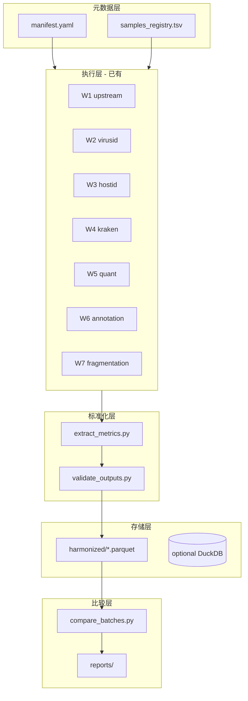

# XvirBench：跨批次一体化分析框架设计（草稿）

> 状态：Draft v0.1  
> 日期：2026-05-26  
> 依赖文档：`docs/WORKFLOW_SUMMARY.md`（七流程总结与可获取指标清单）  
> 执行层：`../Workflows/workflow{1-7}_*`（Snakemake；W7 为独立建库 benchmark，见 §1.4）  
> 项目根目录：`/data/user/guojindan/Projects/XvirBench`

---

## 1. 背景与目标

### 1.1 问题

现有 7 条 Workflows 中，W1–W6 完成宏转录组病毒分析，W7 完成 RNA vs cDNA 打断建库方法学比较，但存在：

- 输出分散在各 `example/` 或自定义 `outdir`，格式不一（JSON、TSV、XLSX、CSV）
- 跨批次比较时，样本 ID、参考序列版本、数据库版本未显式登记
- RPM、Bracken 丰度、病毒 contig ID 等核心指标缺少统一长表，难以做批次间 QC 与趋势分析

### 1.2 目标

构建 **XvirBench** 比较层，实现：

1. **同一尺度**：统一元数据（batch / sample / group / method）与指标 ID（见 WORKFLOW_SUMMARY 中 W1-R01…W7-F21）
2. **同一指标**：固定列名、单位、粒度（run / sample / contig / taxon / method）
3. **可追溯**：manifest 记录软件、数据库、流程参数、宿主参考版本与建库 `method`
4. **可扩展**：新增批次仅登记 + 跑流程 + 抽取，不修改各 workflow 规则

### 1.3 非目标（v0.1 不做）

- 不重写 W1–W7 的 Snakemake 规则
- 不替代各 workflow 自带 HTML/PDF 报告
- 不强制所有批次重比对到统一参考（作为可选策略 B，见 §5）

### 1.4 Workflow 7（建库方法学）的定位

| 维度 | 说明 |
|------|------|
| 流程 | `workflow7_fragmentation_benchmark` |
| 比较维度 | `method` 列（如 `RNA_Frag` vs `cDNA_Frag`），非 `batch_id` |
| 主输出 | `summary/comparison_summary.tsv`（已宽表合并，可直接 ingest） |
| 与 W1 衔接 | 可使用 W1 `merge/{sample}/cleanreads_*.fq.gz` 作为输入，但需在 registry 中单独登记 W7 运行 |
| harmonized 表 | `fragmentation_benchmark.parquet`（可选模块，见 §6.2） |

跨批次比较时：**同一宿主参考版本（fasta+gtf）** 与 **相同 read_length / sjdb_overhang** 必须在 manifest 中锁定，否则 STAR/Picard 指标不可比。

---

## 2. 架构概览



**原则**：执行与比较解耦；比较层只读 workflow 输出。

---

## 3. 目录结构

```
Projects/
├── Workflows/
│   ├── workflow1_upstream/ ... workflow7_fragmentation_benchmark/
│   └── docs/
│       └── WORKFLOW_SUMMARY.md                           # 流程 + 指标字典
└── XvirBench/                                            # 本框架根目录
    ├── DESIGN.md                                         # 本文档
    ├── README.md
    ├── cohorts/                                          # 队列元数据
    ├── schema/
    │   ├── metrics_schema.yaml                           # 指标 ID → 列定义
    │   └── samples_registry.example.tsv
    ├── batches/
    │   ├── {batch_id}.yaml                               # manifest
    │   └── {batch_id}/                                   # 运行输出（可符号链接）
    │       ├── lists/
    │       ├── logs/
    │       ├── reports/
    │       └── workflow1_upstream/ ...
    ├── references/
    │   └── viral_ref_v{YYYYMMDD}/
    ├── harmonized/
    │   ├── qc_upstream.parquet
    │   └── ...
    ├── comparisons/
    ├── scripts/
    │   ├── xvirbench_env.sh
    │   ├── run_w1_to_w5.sh
    │   ├── extract_metrics.py                            # 待实现
    │   └── reports/
    └── docs/                                               # → Workflows/docs 软链
```

---

## 4. 元数据规范

### 4.1 `samples_registry.tsv`

| 列名 | 必填 | 说明 |
|------|------|------|
| `global_sample_id` | 是 | 全局唯一，建议 `{batch_id}__{local_sample_id}` |
| `batch_id` | 是 | 批次标识，如 `2024Q1_labA` |
| `local_sample_id` | 是 | 批次内样本名，对应各 workflow 的 sample_id |
| `group` | 否 | 实验分组（对照/处理/地点/时间点） |
| `library_method` | 否 | W7 专用：`RNA_Frag` / `cDNA_Frag` 等，对应 samples.txt 的 `method` |
| `w1_run_ids` | 否 | 逗号分隔的 run_id（W1 多样本合并用） |
| `raw_fq1` / `raw_fq2` | 否 | 原始 FASTQ 路径（审计用） |
| `notes` | 否 | 自由文本 |

### 4.2 `manifest.yaml`（每批次一份）

```yaml
batch_id: "2024Q1_labA"
created_at: "2026-05-26"
description: "某项目第一批宏转录组"

sequencing:
  platform: "Illumina NovaSeq"
  read_length: 150
  layout: "PE"

workflows:
  workflow1_upstream:
    output_dir: "batches/2024Q1_labA/outputs/workflow1_upstream/example"
    config_snapshot: "batches/2024Q1_labA/config/workflow1_config.yaml"
  workflow2_virusid:
    output_dir: "..."
    search_viraltype: "RNA"
    iteration_time: 5
  # workflow3-6 同理
  workflow7_fragmentation_benchmark:
    output_dir: "..."
    reference_fasta: "..."
    reference_gtf: "..."
    read_length: 150
    enabled: false   # 仅在建库比较项目中设为 true

databases:
  kraken2: "/data/user/guojindan/Databases/Kraken/Standard_20240112"
  checkv: "/data/user/guojindan/Databases/CheckV/checkv-db-v1.5"
  rrna_bowtie2: "/data/user/guojindan/Databases/zhongda_rRNAdb/zhongda_rRNAdb"

reference_policy:
  virus_quantification: "per_batch"   # per_batch | unified
  unified_reference: null             # 若 unified，指向 references/viral_ref_v*/

software_bundle: "/data/user/guojindan/softwares/xvirmin"
```

### 4.3 全局 ID 规则

- 所有 harmonized 表必须含：`batch_id`, `global_sample_id`, `local_sample_id`
- contig 级表额外含：`contig_id`（与 workflow 内 ID 一致）
- 抽取时写入：`metric_id`, `source_workflow`, `source_file`, `extracted_at`

---

## 5. 跨批次可比性策略

### 5.1 测序深度与 QC（W1 + W5）

| 指标 | 归一化 | 说明 |
|------|--------|------|
| 原始 / fastp / clean reads | 报告绝对值 + 保留率 | W1-R01–R19；批次间比较保留率、Q30 |
| `total_clean_reads` | 绝对值 | W5-Q01；RPM 分母，用于判断深度是否可比 |
| RPM | 已按深度归一化 | W5-Q08；**核心丰度指标** |

**深度可比性检查（QC 规则）**：

- 同比较组内 `total_clean_reads` 极差比 >10 时 flagged
- fastp 后保留率 <50% 或 Q30<0.8 时 flagged

### 5.2 微生物群落（W4）

| 指标 | 归一化 | 说明 |
|------|--------|------|
| `fraction_total_reads` | 已是相对丰度 | 可直接比较 |
| `new_est_reads` | 可选转为相对丰度或 CLR | 组成型数据慎用绝对 reads |
| 未分类比例 W4-K01 | 绝对值 | 批次间 QC |

**要求**：所有批次使用 **同一 Kraken 数据库版本**（manifest 登记）。

### 5.3 病毒鉴定与丰度（W2 + W5）

**策略 A — 批次内可比（默认）**

- 每批次 W5 使用本批次 W2 的 `putative_viralcontigs.fna`
- 跨批次比较 **病毒分类/簇** 而非 contig ID
- 实现：`build_virus_cluster_map.py` 基于 NT best-hit taxid、RdRp 结构域或 ANI80 簇合并

**策略 B — 跨批次 RPM 严格可比（可选）**

- 合并各批次 `rep_vert_viruses.fna` → `references/viral_ref_v*/`
- 全批次 W5 使用同一 `reference_fasta` 重跑或增量比对
- manifest.`reference_policy.virus_quantification: unified`

### 5.4 宿主与注释（W3 + W6）

- 宿主：统一到 **物种级** `inferred_mt_species`（W3-H04）
- 注释：按 `seq_id` 或 virus_cluster_id 对齐 W6-A05–A08

### 5.5 建库打断方法（W7）

| 指标 | 归一化 / 比较方式 |
|------|-------------------|
| `uniquely_mapped_pct` 等 | 按 `method` 分组求均值/中位数；报告 replicate 间 SD |
| `median_5prime_to_3prime_bias` | 方法间直接比较（Picard 定义） |
| `percent_duplication` | 方法间比较；可与 W1 测序深度联合解读 |
| `chimeric_rate_pct` | 方法间比较 |
| Preseq（W7-F15–F16） | 可选纳入；需统一 `preseq_extrapolation` |

**分组键**：优先 `method`，其次 `batch_id`（若多批次重复同一建库实验）。

**宿主参考**：`reference.fasta` + `reference.gtf` 的版本 hash 写入 `reference_version` 列。

---


## 6. Harmonized 数据模型

### 6.1 长表通用结构（`metrics_long`）

| 列 | 类型 | 说明 |
|----|------|------|
| `batch_id` | string | 批次 |
| `global_sample_id` | string | 全局样本 ID |
| `local_sample_id` | string | 本地样本 ID |
| `granularity` | enum | run / sample / contig / taxon / gene |
| `entity_id` | string | 可选；contig_id、taxon name 等 |
| `metric_id` | string | 如 W1-R01, W5-Q08 |
| `metric_name` | string | 人类可读名 |
| `value` | float/string | 值 |
| `unit` | string | reads / bp / % / RPM / … |
| `source_workflow` | string | workflow1_upstream … |
| `source_file` | string | 相对 batch outputs 的路径 |
| `reference_version` | string | 可选；W5 参考 FASTA 的 hash 或版本标签 |
| `extracted_at` | timestamp | 抽取时间 |

### 6.2 主题宽表（由长表透视，供分析）

| 文件 | 主键 | 核心列（示例） |
|------|------|----------------|
| `qc_upstream.parquet` | global_sample_id | raw_reads, clean_reads, rrna_retention, contig_count, contig_total_bp, contig_n50_proxy |
| `virus_identification.parquet` | global_sample_id, contig_id | length, completeness, checkv_quality, viral_type, nt_species, cluster_id |
| `virus_quantification_rpm.parquet` | global_sample_id, reference_id | mapped_reads, coverage, mean_depth, rpm, total_clean_reads |
| `microbiome_bracken.parquet` | global_sample_id, taxon_id | level, name, fraction, new_est_reads |
| `host_identification.parquet` | global_sample_id | inferred_mt_species, ND1_pident, … |
| `virus_annotation.parquet` | contig_id | predicted_genes, rdrp_detected, taxonomy_consistent |
| `fragmentation_benchmark.parquet` | global_sample_id, method | uniquely_mapped_pct, median_5prime_to_3prime_bias, percent_duplication, chimeric_rate_pct, … |

完整 metric_id 列表见 `../docs/WORKFLOW_SUMMARY.md` 各节「可获取指标」表。

**W7 快捷路径**：`comparison_summary.tsv` 已是宽表，抽取时可整表读入并追加 `batch_id`、`global_sample_id`，列名与 W7-F01–F14 一一对应。

---

## 7. 抽取流水线（`extract_metrics.py`）

### 7.1 输入

```bash
python benchmark/scripts/extract_metrics.py \
  --batch-id 2024Q1_labA \
  --manifest benchmark/batches/2024Q1_labA/manifest.yaml \
  --registry benchmark/batches/2024Q1_labA/samples_registry.tsv \
  --out-dir benchmark/harmonized/
```

### 7.2 模块与源路径映射

| 模块 | workflow | 必读文件 | 产出 |
|------|----------|----------|------|
| upstream_qc | W1 | `01_fastp.json`, `cleanreads_*.stat.txt`, `*.contigs.stat.txt`, `*.contigs.1kb.renamed.fa` | qc_upstream |
| virus_id | W2 | `putative_viralcontigs.lenstat.tsv`, `checkv/quality_summary.tsv`, `cluster_summary.csv`, `nt_result.csv` | virus_identification |
| virus_quant | W5 | `cleanreads_count.txt`, `rpm.csv` | virus_quantification_rpm |
| microbiome | W4 | `combined_species.txt`, `{sample}.report` | microbiome_bracken |
| host | W3 | `final_results.xlsx`, `depths.txt` | host_identification |
| annotation | W6 | `annotation_summary.csv`, `consistency_report.tsv` | virus_annotation |
| fragmentation | W7 | `summary/comparison_summary.tsv`；可选 `preseq/*`, `Log.final.out` | fragmentation_benchmark |

### 7.3 校验（`validate_outputs.py`）

- manifest 中声明的 `output_dir` 存在
- 每个 `global_sample_id` 在 W1 merge/assembly 有对应目录
- W5 `rpm.csv` 中 `total_clean_reads` 与 W1 clean reads 数量级一致（±5% 警告）
- 必填 metric_id 非空率 >95%

---

## 8. 比较分析模块

### 8.1 配置 `comparisons/{id}/config.yaml`

```yaml
comparison_id: "flu_surveillance_2024"
batches:
  - 2024Q1_labA
  - 2024Q2_labB
sample_filter:
  groups: ["clinical", "environmental"]   # 可选
metrics:
  - qc_upstream
  - virus_quantification_rpm
  - microbiome_bracken
analyses:
  - qc_panel
  - rpm_heatmap
  - bracken_pcoa
  - virus_detection_rate
reference_policy: per_batch   # 或 unified
```

### 8.2 分析清单（v0.1）

| 分析 ID | 输入 | 输出 | 用途 |
|---------|------|------|------|
| `qc_panel` | qc_upstream | 箱线图/表：reads 漏斗、Q30、rRNA 保留、组装规模 | 剔除低质量样本 |
| `depth_scatter` | W5 total_clean_reads | 样本深度分布 | 判断 RPM 可比性 |
| `rpm_heatmap` | virus_quantification_rpm + cluster_map | Top-N 病毒 RPM 热图 | 核心生物学比较 |
| `virus_detection_rate` | rpm + cluster_map | 病毒在批次/组中的检出率 | 流行病学式比较 |
| `bracken_pcoa` | microbiome_bracken（species） | PCoA + PERMANOVA | 群落结构差异 |
| `host_summary` | host_identification | 宿主组成表 | 背景解释 |
| `annotation_qc` | virus_annotation | RdRp 检出率、一致性通过率 | 注释流程 QC |
| `fragmentation_compare` | fragmentation_benchmark | 按 method 的箱线图/表：比对率、偏倚、重复、嵌合 | RNA vs cDNA 建库决策 |

### 8.3 报告

- 模板：`benchmark/reports/templates/batch_comparison.md.j2`
- 输出：`benchmark/comparisons/{id}/results/report.html`（或 PDF）
- 嵌入图表：QC 漏斗、RPM 热图、PCoA

---

## 9. 实施路线图

| 阶段 | 内容 | 交付物 |
|------|------|--------|
| **P0** | 指标字典定稿 | `WORKFLOW_SUMMARY.md`（已完成）、`schema/metrics_schema.yaml` |
| **P1** | 单批次抽取 | `extract_metrics.py` + 1 个 batch 示例 |
| **P2** | 校验 + 双批次比较 | `validate_outputs.py`, `compare_batches.py`, QC 面板 |
| **P3** | 病毒簇映射 | `build_virus_cluster_map.py` |
| **P4** | 统一参考（可选） | `references/viral_ref_v*` + W5 重跑文档 |
| **P5** | 顶层编排（可选） | `benchmark/Snakefile` 调用 W1–W6 + extract |
| **P6** | W7 纳入（可选） | 读入 `comparison_summary.tsv` → `fragmentation_benchmark.parquet` |

---

## 10. 与现有 Workflows 的集成方式

### 10.1 批次完成后

```bash
# 1. 跑完各 workflow（示例）
cd workflow1_upstream && snakemake -j 16 ...
cd workflow2_virusid && snakemake -j 48 ...
# ...

# 2. 登记批次
cp benchmark/schema/samples_registry.example.tsv \
   benchmark/batches/BATCH_001/samples_registry.tsv
# 编辑 manifest + registry

# 3. 同步或软链输出到 batches/BATCH_001/outputs/

# 4. 抽取
python benchmark/scripts/extract_metrics.py --batch-id BATCH_001 ...
```

### 10.2 不修改 workflow 的约定

- 比较层 **只读** `{outdir}` 下标准路径（与 README 一致）
- 若 workflow 升级输出路径，同步更新 `metrics_schema.yaml` 与 extract 脚本
- 参数变更必须写入 `manifest.yaml` 的 `config_snapshot`

---

## 11. 风险与约束

| 风险 | 缓解 |
|------|------|
| 不同批次 Kraken/CheckV 库版本不一致 | manifest 强制登记；比较前版本校验 |
| W5 参考 contig ID 不可比 | 默认策略 A + virus_cluster_map |
| Excel 解析依赖 | W2/W3 使用 openpyxl；提供 CSV 导出备选 |
| 大文件 JSON 解析慢 | W1 fastp 仅抽 summary 节点 |
| 样本名含特殊字符 | registry 禁止空格；global_sample_id 规范化 |

---

## 12. 附录

### 12.1 最小跨批次指标集（MVP）

用于首批 2+ 批次对比，**至少**抽取：

1. W1-R01, W1-R07, W1-R15, W1-R19, W1-R20, W1-R24（reads 漏斗 + 组装）
2. W2-V01, W2-V04, W2-V16（病毒鉴定规模与质量）
3. W5-Q01, W5-Q02, W5-Q08（深度与 RPM）
4. W4-K01, W4-K04（未分类与物种丰度）
5. W3-H04, W3-H01（宿主与标记覆盖）
6. W6-A05, W6-A07, W6-A08（注释）

**建库方法学子集（启用 W7 时）**：

7. W7-F01–F04（STAR 比对率）
8. W7-F05–F07（偏倚与重复）
9. W7-F10, W7-F11–F13（嵌合与剪接）

### 12.2 相关路径

| 资源 | 路径 |
|------|------|
| 流程总结与指标 | `../docs/WORKFLOW_SUMMARY.md` |
| 项目 README | `../README.md` |
| 规范 | `../STANDARDS.md` |
| XvirMind 结构参考 | `/data/user/guojindan/Projects/XvirMind/docs/workflow_structure.md` |
| W7 流程 README | `../workflow7_fragmentation_benchmark/README.md` |
| W7 研究方案 | `../metatranscriptomics-rna-vs-cdna-fragmentation-benchmark.md` |

---

*Draft v0.2 — 纳入 W7 建库 benchmark；待 P1/P6 实现抽取脚本。*
