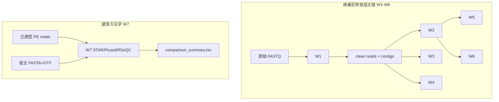

# Workflows 七流程总结（含可获取指标）

> 路径：`/data/user/guojindan/Projects/Workflows`  
> 配套框架设计见：`benchmark/DESIGN.md`  
> 修订日期：2026-05-26

---

## 总览

| ID | 目录 | 定位 | 典型上游 | 典型下游 |
|----|------|------|----------|----------|
| W1 | `workflow1_upstream` | 质控、去 rRNA、合并、组装 | 原始 PE FASTQ | W2/W3/W4/W5 |
| W2 | `workflow2_virusid` | 迭代 HMM 病毒鉴定 + BLAST + 聚类 | W1 contigs | W5/W6 |
| W3 | `workflow3_hostid` | EukaMarker 宿主鉴定 | W1 clean reads + contigs | 整合解读 |
| W4 | `workflow4_kraken_bracken` | Kraken2 + Bracken 微生物谱 | W1 clean reads | 群落比较 |
| W5 | `workflow5_virus_quantification` | 病毒 contig RPM 定量 | W2 参考 + W1 clean reads | 丰度比较 |
| W6 | `workflow6_virus_annotation` | CheckV + 结构/功能注释 + GenBank | W2 病毒序列 + taxonomy | 交付注释 |
| W7 | `workflow7_fragmentation_benchmark` | **RNA vs cDNA 打断**建库方法学比较 | 已质控 clean PE reads + 宿主参考 | 建库决策 / XvirBench |

**病毒分析链推荐顺序**：W1 →（W2 ∥ W3 ∥ W4）→ W5 → W6  

**W7** 为独立方法学 benchmark，与 W1–W6 并行，不替代上游质控；研究方案见 `metatranscriptomics-rna-vs-cdna-fragmentation-benchmark.md`。



---

## Workflow 1：上游预处理

### 流程目标

将原始双端测序数据质控、去除 rRNA、合并同一样本多 run、Megahit 组装，产出 **clean reads** 与 **≥1 kb 重命名 contigs**，供下游鉴定与定量。

### 数据流

```
原始 fq1/fq2
  → U1 fastp（质控、接头、低质量过滤）
  → U2 bowtie2（去 rRNA）
  → U3 merge（同 sample 多 run 合并）
  → U4 megahit（组装，min-contig-len 300）
  → U5 seqkit（≥1 kb 过滤 + 重命名）
```

### 工具与数据库

| 类型 | 名称 |
|------|------|
| 软件 | fastp, bowtie2, samtools, megahit, seqkit |
| 数据库 | rRNA Bowtie2 索引（默认 `zhongda_rRNAdb`） |
| 安装根目录 | `/data/user/guojindan/softwares/xvirmin` |

### 关键参数

| 参数 | 默认值 / 说明 |
|------|----------------|
| `params.fastp` | Q20、长度≥50、接头检测、去重、低复杂度过滤等 |
| `params.bowtie2` | `--local` |
| `params.megahit` | 内存 20G、`--min-contig-len 300` |
| U5 过滤 | contig 长度 **≥1000 bp** |

### 主要输出文件

| 路径模式 | 说明 |
|----------|------|
| `filter/{run_id}/01_fastp_r1.fq.gz`, `01_fastp_r2.fq.gz` | fastp 后 reads |
| `filter/{run_id}/01_fastp.json`, `01_fastp.html` | 质控报告 |
| `filter/{run_id}/01_fastp_r*.fq.stat.txt` | fastp 后 seqkit 统计 |
| `filter/{run_id}/cleanreads_r*.fq.gz` | 去 rRNA 后 reads |
| `filter/{run_id}/cleanreads_r*.fq.stat.txt` | 去 rRNA 后 seqkit 统计 |
| `merge/{sample_id}/cleanreads_r*.fq` | 样本级合并 reads |
| `merge/{sample_id}/cleanreads_r*.fq.stat.txt` | 合并后统计 |
| `assembly/{sample_id}/{sample_id}.contigs.fa` | 全部组装 contigs |
| `assembly/{sample_id}/{sample_id}.contigs.stat.txt` | 组装统计 |
| `assembly/{sample_id}/{sample_id}.contigs.1kb.renamed.fa` | **最终 contigs（≥1 kb）** |

### 主要生物学/技术结果

- 数据是否达到下游分析要求（Q30、保留率、rRNA 比例）
- 每样本可用 clean reads 规模与组装规模（contig 数、总碱基、N50 代理：max/avg）

### 可获取指标（标准化抽取用）

| 指标 ID | 指标名称 | 粒度 | 来源文件 | 字段 / 提取方式 | 单位 |
|---------|----------|------|----------|-----------------|------|
| W1-R01 | 原始 reads 数（过滤前） | run | `filter/{run}/01_fastp.json` | `summary.before_filtering.total_reads` | reads |
| W1-R02 | 原始碱基数（过滤前） | run | 同上 | `summary.before_filtering.total_bases` | bp |
| W1-R03 | 原始 Q20 比例 | run | 同上 | `summary.before_filtering.q20_rate` | 比例 |
| W1-R04 | 原始 Q30 比例 | run | 同上 | `summary.before_filtering.q30_rate` | 比例 |
| W1-R05 | 原始 GC 含量 | run | 同上 | `summary.before_filtering.gc_content` | 比例 |
| W1-R06 | 原始平均读长 | run | 同上 | `summary.before_filtering.read1_mean_length` 等 | bp |
| W1-R07 | fastp 后 reads 数 | run | 同上 | `summary.after_filtering.total_reads` | reads |
| W1-R08 | fastp 后碱基数 | run | 同上 | `summary.after_filtering.total_bases` | bp |
| W1-R09 | fastp 后 Q30 比例 | run | 同上 | `summary.after_filtering.q30_rate` | 比例 |
| W1-R10 | 通过过滤 reads 数 | run | 同上 | `filtering_result.passed_filter_reads` | reads |
| W1-R11 | 低质量/过短/低复杂度剔除数 | run | 同上 | `filtering_result.low_quality_reads` 等 | reads |
| W1-R12 | 重复率 | run | 同上 | `duplication.rate` | 比例 |
| W1-R13 | 接头修剪 reads 数 | run | 同上 | `adapter_cutting.adapter_trimmed_reads` | reads |
| W1-R14 | fastp 后 R1 reads（seqkit） | run | `01_fastp_r1.fq.stat.txt` | `num_seqs`（R1+R2 需分文件） | reads |
| W1-R15 | 去 rRNA 后 R1 reads | run | `cleanreads_r1.fq.stat.txt` | `num_seqs` | reads |
| W1-R16 | 去 rRNA 后 R1 碱基 | run | 同上 | `sum_len` | bp |
| W1-R17 | 去 rRNA 保留率 | run | 计算 | R15 / R14（或相对 fastp 后双端总和） | 比例 |
| W1-R18 | 合并后 R1 reads | sample | `merge/{sample}/cleanreads_r1.fq.stat.txt` | `num_seqs` | reads |
| W1-R19 | 合并后总 clean reads（双端） | sample | 计算 | R1+R2 的 `num_seqs` 之和 | reads |
| W1-R20 | 组装 contig 数 | sample | `{sample}.contigs.stat.txt` | `num_seqs` | 个 |
| W1-R21 | 组装总碱基 | sample | 同上 | `sum_len` | bp |
| W1-R22 | 组装平均 contig 长度 | sample | 同上 | `avg_len` | bp |
| W1-R23 | 组装最长 contig | sample | 同上 | `max_len` | bp |
| W1-R24 | ≥1 kb contig 数 | sample | 对 `*.contigs.1kb.renamed.fa` 做 seqkit stat | `num_seqs` | 个 |
| W1-R25 | ≥1 kb 总碱基 | sample | 同上 | `sum_len` | bp |

**输入格式**：`run_id sample_id fq1 fq2`（`data/samples.txt`）

---

## Workflow 2：病毒鉴定

### 流程目标

从组装 contigs 经 ORF 预测与迭代 HMM（RNA RdRp / DNA 标记）鉴定候选病毒，经 CheckV、聚类、多库 BLAST 后输出汇总表与代表序列。

### 数据流

```
contigs.fna
  → getorf（≥600 bp）
  → 迭代 HMM（RNA/DNA，默认 5 轮）
  → coverage / fetch_contigs / CheckV
  → MMSeqs ANI80 + AAI95 聚类
  → megablast NT、blastx NR/VHDB、hmmsearch RdRp-scan
  → Excel 汇总 + 代表 FASTA
```

### 工具与数据库

| 类型 | 名称 |
|------|------|
| 软件 | getorf, hmmsearch, diamond, blastn, mmseqs, checkv, seqkit, iterativehmmsearch |
| 数据库 | rdrpscan HMM、DNA virus markers、nr、nt、vhdb、CheckV v1.5 |

### 关键参数

| 参数 | 默认 |
|------|------|
| `SEARCH_VIRALTYPE` | `RNA`（可选 DNA / RNA+DNA） |
| `RNA_SEARCHMODE` | `fast` |
| `ITERATION_TIME` | `5` |
| `RENAME_CONTIGS` | `true` |
| ORF `minsize` | 600 bp |

### 主要输出文件

| 路径 | 说明 |
|------|------|
| `Assembly/orfs.full.faa`, `contigs.full.fna` | 全量 ORF / contigs |
| `output_rna/Iteration_{i}/hmmsearch.domtblout` | 迭代 HMM 结果 |
| `downstream/sequences/putative_viralcontigs/putative_viralcontigs.fna` | **候选病毒核酸** |
| `downstream/sequences/putative_viralcontigs.lenstat.tsv` | 候选病毒长度 |
| `downstream/sequences/coverage.csv` | HMM 命中与病毒类型 |
| `downstream/sequences/checkv/quality_summary.tsv` | CheckV 质量 |
| `downstream/cluster/ANI80_cluster.tsv`, `AAI95_*.tsv`, `cluster_summary.csv` | 聚类 |
| `downstream/blast/{nt,nr,vhdb}/*_result.csv` | BLAST 解析表 |
| `downstream/blast/hmmsearch_RdRpscan/rdrpscan_result.csv` | RdRp scan |
| `summary/tables/{fullinfo,vertebrate_viruses,viruses}.xlsx` | **汇总表** |
| `summary/sequences/rep_vert_viruses.fna` | 脊椎动物病毒代表序列 |

### 主要结果

- 候选病毒 contig 列表及数量、长度分布
- CheckV 完整度与质量等级分布
- 聚类簇数与代表序列
- NT/NR/VHDB 最佳分类与脊椎动物病毒子集

### 可获取指标

| 指标 ID | 指标名称 | 粒度 | 来源文件 | 字段 / 提取方式 | 单位 |
|---------|----------|------|----------|-----------------|------|
| W2-V01 | 候选病毒 contig 数 | sample | `putative_viralcontigs.lenstat.tsv` | 行数 | 个 |
| W2-V02 | 候选病毒总碱基 | sample | 同上 | length 列求和 | bp |
| W2-V03 | 单条 contig 长度 | contig | 同上 | `length` | bp |
| W2-V04 | CheckV 完整度 | contig | `checkv/quality_summary.tsv` | `completeness` | % |
| W2-V05 | CheckV 质量等级 | contig | 同上 | `checkv_quality` | 分类 |
| W2-V06 | CheckV 污染度 | contig | 同上 | `contamination` | % |
| W2-V07 | 病毒基因数 / 宿主基因数 | contig | 同上 | `viral_genes`, `host_genes` | 个 |
| W2-V08 | HMM 病毒类型 | contig | `coverage.csv` | `viral_type` | RNA/DNA |
| W2-V09 | HMM 命中结构域 | contig | `coverage.csv` | `besthit_hmm` | 文本 |
| W2-V10 | ANI80 聚类簇数 | sample | `cluster_summary.csv` | `clusid` 去重计数 | 个 |
| W2-V11 | 代表 contig ID | contig | `cluster_summary.csv` | `clus_repseq`, `clus_sign` | ID |
| W2-V12 | NT 最佳物种 | contig | `nt/nt_result.csv` | `nt_ssciname`, `nt_pident`, `nt_qcovs` | 文本 / % |
| W2-V13 | NR 最佳命中 | contig | `nr/nr_result.csv` | 解析列（物种、bitscore 等） | — |
| W2-V14 | VHDB 最佳命中 | contig | `vhdb/vhdb_result.csv` | 解析列 | — |
| W2-V15 | RdRp-scan 命中 | contig | `rdrpscan_result.csv` | 是否命中 | 布尔 |
| W2-V16 | 脊椎动物病毒数 | sample | `vertebrate_viruses.xlsx` | 行数 | 个 |
| W2-V17 | 代表脊椎动物病毒数 | sample | `rep_vert_viruses.seqid.list` | 行数 | 个 |
| W2-V18 | 迭代 HMM 每轮命中数 | sample | `output_rna/Iteration_*/profile_covstat.tsv` | 按轮汇总 | 个 |

**输入格式**：`sample_id contigs_path`

---

## Workflow 3：宿主鉴定

### 流程目标

基于真核线粒体标记基因（CYTB、COI、ND1，EukaMarker），结合 reads 覆盖度与 contigs BLAST，推断样本宿主物种。

### 数据流

```
clean reads + contigs
  → H1 bowtie2 → EukaMarker
  → H2 samtools coverage（覆盖度≥40）
  → H3 contigs megablast
  → H4 整合 depths + blast
  → H5 final_results.xlsx
```

### 工具与数据库

| 类型 | 名称 |
|------|------|
| 软件 | bowtie2, samtools, blastn, result_summarize.py |
| 数据库 | EukaMarker bowtie2 索引 + BLAST 库 |

### 关键参数

- 比对：AS>100，NM<10
- 覆盖度阈值：**≥40**
- BLAST：identity≥90%，length≥300 bp
- 多标记基因投票定最终宿主

### 主要输出文件

| 路径 | 说明 |
|------|------|
| `EukaMarker_Mapping/1.sortedbam/{sample}_sorted.bam` | 比对 BAM |
| `EukaMarker_Mapping/2.filteredcoverage_q0/{sample}_coverage.txt` | 单样本覆盖度 |
| `EukaMarker_megablast/2.result_filtered/{sample}.blastn` | 过滤 BLAST |
| `depths.txt` | 全样本覆盖度汇总 |
| `blastresult.full.txt` | 全样本 BLAST 汇总 |
| `final_results.xlsx` | **最终宿主鉴定** |

### 主要结果

- 推断宿主物种/属及置信度
- 各标记基因（ND1/CYTB/COI）支持情况
- 已知/未知物种标注

### 可获取指标

| 指标 ID | 指标名称 | 粒度 | 来源文件 | 字段 / 提取方式 | 单位 |
|---------|----------|------|----------|-----------------|------|
| W3-H01 | 标记基因覆盖度 | sample×marker | `depths.txt` | 第 7 列 `COVERAGE` | % |
| W3-H02 | 标记基因 mapped reads | sample×marker | `depths.txt` | 第 5 列 `NUMREADS` | reads |
| W3-H03 | 标记基因平均深度 | sample×marker | `depths.txt` | 第 8 列 `MEANDEPTH` | × |
| W3-H04 | 推断线粒体物种 | sample | `final_results.xlsx` | `inferred_mt_species` | 文本 |
| W3-H05 | 推断线粒体属 | sample | 同上 | `inferred_mt_genus` | 文本 |
| W3-H06 | 物种级标记基因数 | sample | 同上 | `species_level_marker_count` | 个 |
| W3-H07 | 注释物种数 | sample | 同上 | `annotated_species_count` | 个 |
| W3-H08 | 是否已知物种 | sample | 同上 | `known_species` | 布尔/分类 |
| W3-H09 | ND1/CYTB/COI 物种与一致性 | sample | 同上 | `ND1_species`, `ND1_pident` 等 | 文本 / % |
| W3-H10 | 非最优属数量 | sample | 同上 | `notbest_genus` | 个 |
| W3-H11 | contigs BLAST 最佳命中 | contig | `blastresult.full.txt` | identity, bitscore 等 | — |

**输入格式**：`sample_id fq1 fq2 assembly`

---

## Workflow 4：Kraken2 + Bracken

### 流程目标

对 clean reads 进行 k-mer 分类，并在种/属/科水平估计微生物相对丰度，用于群落结构与跨批次比较。

### 数据流

```
clean reads → Kraken2 → Bracken (S/G/F) → combine 跨样本矩阵
```

### 工具与数据库

| 类型 | 名称 |
|------|------|
| 软件 | kraken2, bracken, combine_bracken_outputs.py |
| 数据库 | Kraken Standard_20240112 |

### 关键参数

| 参数 | 默认 |
|------|------|
| `kraken2_confidence` | 0.3 |
| `bracken_readlen` | 150 |
| `bracken_threshold` | 10 |
| `bracken_levels` | S, G, F |

### 主要输出文件

| 路径 | 说明 |
|------|------|
| `kraken2/{sample}.kraken` | 原始分类 |
| `kraken2/{sample}.report` | Kraken 层级报告 |
| `bracken/{sample}_{species,genus,family}.txt` | 各级 Bracken 丰度 |
| `summary/combined_{species,genus,family}.txt` | **跨样本丰度矩阵** |
| `summary/bracken_{level}_summary.txt` | 排序汇总 |

### 主要结果

- 每样本物种/属/科组成与相对丰度
- 未分类比例（Kraken report 第 1 行 unclassified）
- 跨样本合并矩阵（批次比较核心输入）

### 可获取指标

| 指标 ID | 指标名称 | 粒度 | 来源文件 | 字段 / 提取方式 | 单位 |
|---------|----------|------|----------|-----------------|------|
| W4-K01 | Kraken 未分类比例 | sample | `{sample}.report` | 首行 `%` 列 | % |
| W4-K02 | Kraken 各分类单元 reads | sample×taxon | `{sample}.report` | 列：%, reads, taxon | reads |
| W4-K03 | Bracken 估计 reads | sample×taxon | `{sample}_species.txt` | `new_est_reads` | reads |
| W4-K04 | Bracken 相对丰度 | sample×taxon | 同上 | `fraction_total_reads` | 比例 |
| W4-K05 | 分类单元名称与 taxid | sample×taxon | 同上 | `name`, `taxonomy_id` | — |
| W4-K06 | 跨样本物种丰度矩阵 | taxon×sample | `combined_species.txt` | 矩阵列=样本 | reads / % |
| W4-K07 | 病毒谱系丰度（子集） | sample×taxon | 对 combined 表按 lineage 过滤 Viruses | 比例 |
| W4-K08 | Top-N 物种数 | sample | 由 W4-K04 排序截取 | 计数 | 个 |

**Bracken species 列**：`name`, `taxonomy_id`, `taxonomy_lvl`, `kraken_assigned_reads`, `added_reads`, `new_est_reads`, `fraction_total_reads`

**输入格式**：`sample_id fq1 fq2`

---

## Workflow 5：病毒定量

### 流程目标

以 W2 候选病毒 contigs 为参考，将各样本 clean reads 比对并计算 **mapped reads** 与 **RPM**，支持跨样本、跨批次丰度比较（需统一参考版本，见 DESIGN.md）。

### 数据流

```
sample fq → 统计 clean reads 总数 → bowtie2-build → 比对 → samtools coverage
  → 过滤（mapped≥阈值, length≥1000, coverage>40）→ RPM
```

### 工具与数据库

| 类型 | 名称 |
|------|------|
| 软件 | bowtie2, bowtie2-build, samtools |
| 参考 | `reference_fasta`（默认 W2 `putative_viralcontigs.fna`） |

### 关键参数

| 参数 | 默认 |
|------|------|
| `min_mapped_reads` | 0 |
| `min_mapped_length` | 1000 |
| `min_coverage` | 40 |
| RPM | `mapped_reads × 10⁶ / total_clean_reads` |

### 主要输出文件

| 路径 | 说明 |
|------|------|
| `summary/cleanreads_count.txt` | 每样本 clean reads 总数（双端之和） |
| `coverage/{sample}.samtools.coverage` | 单样本 coverage |
| `coverage/merged.coverage`, `filtered.coverage` | 合并/过滤后 |
| `summary/sample_mapped_read.txt` | 过滤后 mapped 记录 |
| `summary/rpm.csv`, `summary.tsv` | **RPM 主表** |

### 主要结果

- 每样本测序深度（total_clean_reads）
- 每病毒 contig 的比对支持度与 RPM 排序表
- 高覆盖、高 RPM 病毒表达谱

### 可获取指标

| 指标 ID | 指标名称 | 粒度 | 来源文件 | 字段 | 单位 |
|---------|----------|------|----------|------|------|
| W5-Q01 | clean reads 总数 | sample | `cleanreads_count.txt` | 第 2 列 | reads |
| W5-Q02 | mapped reads | sample×ref | `rpm.csv` | `mapped_reads` | reads |
| W5-Q03 | 覆盖碱基数 | sample×ref | `rpm.csv` | `covbases` | bp |
| W5-Q04 | 覆盖度 | sample×ref | `rpm.csv` | `coverage` | % |
| W5-Q05 | 平均深度 | sample×ref | `rpm.csv` | `mean_depth` | × |
| W5-Q06 | 平均碱基质量 | sample×ref | `rpm.csv` | `mean_baseq` | Phred |
| W5-Q07 | 平均 MAPQ | sample×ref | `rpm.csv` | `mean_mapq` | — |
| W5-Q08 | RPM | sample×ref | `rpm.csv` | `RPM` | RPM |
| W5-Q09 | 有表达的病毒 contig 数 | sample | `rpm.csv` | `mapped_reads>0` 行数 | 个 |
| W5-Q10 | 最高 RPM 病毒 | sample | `rpm.csv` | 按 RPM 降序首行 | — |
| W5-Q11 | 参考序列 ID | ref | `rpm.csv` | `reference_id` | ID |

**输入格式**：`sample_id fq1 fq2`

---

## Workflow 6：病毒注释

### 流程目标

对已鉴定病毒序列做 CheckV 过滤、结构注释（VIGOR 优先 / Prodigal-meta 兜底）、DRAM-v 功能注释、taxonomy 一致性检查，输出 GenBank。

### 数据流

```
FASTA + taxonomy.tsv
  → CheckV（viral & completeness>50%）
  → 策略分流（taxonomy + 长度）→ VIGOR / Prodigal-meta
  → DRAM-v
  → summary_agent → 逐条 GenBank
```

### 工具与数据库

| 类型 | 名称 |
|------|------|
| 软件 | CheckV, VIGOR4, Prodigal-meta, DRAM-v |
| 数据库 | CheckV v1.5, DRAMv, VIGOR_DB |

### 关键参数

| 参数 | 默认 |
|------|------|
| `min_completeness` | 50 |
| `min_len_for_vigor` | 12000 |
| `strict_tools` | false |

### 主要输出文件

| 路径 | 说明 |
|------|------|
| `checkv/quality_summary.tsv` | CheckV 质量 |
| `summary/strategy.tsv` | 结构注释策略 |
| `structure/vigor/vigor.{faa,gbk,gff3}` | VIGOR 结果 |
| `function/dramv/annotations.tsv` | DRAM-v 注释 |
| `summary/annotation_summary.csv` | **注释汇总** |
| `summary/consistency_report.tsv` | taxonomy 一致性 |
| `genbank/*.gbk` | 逐条 GenBank |

### 主要结果

- 通过质量阈值的病毒序列集
- 基因数、AMG、RdRp 检出与注释策略
- 分类学与标记基因一致性
- 标准 GenBank 交付

### 可获取指标

| 指标 ID | 指标名称 | 粒度 | 来源文件 | 字段 | 单位 |
|---------|----------|------|----------|------|------|
| W6-A01 | CheckV 完整度 | contig | `checkv/quality_summary.tsv` | `completeness` | % |
| W6-A02 | CheckV 质量等级 | contig | 同上 | `checkv_quality` | 分类 |
| W6-A03 | 通过过滤序列数 | batch | 过滤后 FASTA / keep_ids | 计数 | 个 |
| W6-A04 | 结构注释策略 | contig | `summary/strategy.tsv` | VIGOR / Prodigal 列 | 文本 |
| W6-A05 | 预测基因数 | contig | `annotation_summary.csv` | `predicted_genes` | 个 |
| W6-A06 | AMG 命中数 | contig | 同上 | `amg_hits` | 个 |
| W6-A07 | RdRp 是否检出 | contig | 同上 | `rdrp_detected` | 布尔 |
| W6-A08 | taxonomy 一致性 | contig | 同上 / `consistency_report.tsv` | `taxonomy_consistent` | 布尔 |
| W6-A09 | DRAM 基因注释 | gene | `dramv/annotations.tsv` | `annotation`, `amg_flag`, `rdrp_like` | 文本 |
| W6-A10 | 注释通过率 | batch | 计算 | consistent / total | 比例 |

**输入**：`input_fasta` + `taxonomy.tsv`（`seq_id` + `taxonomy`）

---

## Workflow 7：RNA vs cDNA 打断建库比较 (`workflow7_fragmentation_benchmark`)

### 流程目标

在**已完成质控与接头去除**的双端 reads 上，比较 **RNA 直接打断**与 **cDNA 打断**两种宏转录组建库策略对宿主比对、链特异性相关偏倚、基因体覆盖均匀性、文库复杂度、PCR 重复、嵌合体与剪接位点等指标的影响，为建库方案选择提供定量依据。

### 数据流

```
宿主 FASTA + GTF
  → F0 GTF→refFlat/BED12（Picard + RSeQC 注释）
  → F1 STAR 基因组索引
  → F2 STAR 标准比对 → BAM + Log.final.out
  → F3 解析 STAR 比对率
  → F4 Picard CollectRnaSeqMetrics → F5 5′/3′ 偏倚与 CV
  → F6 RSeQC geneBody_coverage（基因体覆盖曲线）
  → F7 Preseq lc_extrap（复杂度外推）
  → F8 Picard MarkDuplicates → 重复率
  → F10–F11 STAR 嵌合比对模式 → 嵌合体率 + SJ 统计
  → F12 合并各 metrics TSV
  → F13 comparison_summary.tsv + run_report.md
```

### 工具与数据库

| 类型 | 名称 |
|------|------|
| 软件 | STAR, samtools, Picard, Preseq, RSeQC (`geneBody_coverage.py`), snakemake, pandas |
| 环境 | micromamba `metatrans_compare`（`/data/user/guojindan/softwares`） |
| 参考（用户准备） | 宿主 `fasta` + `gtf`（如小鼠 GRCm39、蜱 GCF_016920785 等） |
| 流程自动生成 | `host.refFlat`, `host.bed12`, `star_index/` |

### 关键参数

| 参数 | 说明 |
|------|------|
| `reference.read_length` | 测序读长；`params.sjdb_overhang` 建议 **read_length − 1** |
| `params.sjdb_overhang` | STAR splice junction 悬垂（模拟配置 49，对应 read_length 50） |
| `params.star_use_sjdb` | 是否使用 GTF 剪接数据库（真实数据建议 `true`） |
| `params.preseq_extrapolation` | Preseq 外推深度上限（默认 500000） |
| `threads.star` | STAR 线程数（默认 4） |

### 主要输出文件

| 路径模式 | 说明 |
|----------|------|
| `reference/annotation/host.refFlat`, `host.bed12` | F0 注释衍生 |
| `reference/star_index/` | F1 STAR 索引 |
| `alignment/{sample}/Aligned.sortedByCoord.out.bam` | 标准比对 BAM |
| `alignment/{sample}/Log.final.out` | STAR 比对统计原文 |
| `metrics/alignment_stats.tsv` | 各样本比对率汇总 |
| `metrics/rnaseq_metrics.tsv` | Picard RNA-seq 偏倚汇总 |
| `metrics/duplication_metrics.tsv` | PCR 重复率汇总 |
| `metrics/chimera_stats.tsv` | 嵌合体与剪接汇总 |
| `metrics/picard/{sample}_RNA_metrics.txt` | Picard 原始 metrics |
| `metrics/duplication/{sample}_dup_metrics.txt` | MarkDuplicates 原文 |
| `metrics/preseq/{sample}_complexity.txt` | Preseq 外推表 |
| `metrics/genebody/{sample}.geneBodyCoverage.txt` | RSeQC 基因体覆盖（含 PDF 曲线） |
| `summary/comparison_summary.tsv` | **最终合并比较表（按 method 分组）** |
| `summary/run_report.md` | 按 method 汇总的运行摘要 |

### 主要结果

- **RNA_Frag** vs **cDNA_Frag**（或用户自定义 `method`）在宿主比对率、5′→3′ 偏倚、覆盖均匀性上的差异
- PCR 重复率与 Preseq 文库复杂度对比
- 嵌合体比例及已知/新剪接位点数量
- `run_report.md` 中按 method 的均值摘要（如 mean uniquely mapped %）

### 可获取指标

#### 已并入 `comparison_summary.tsv` 的指标

| 指标 ID | 指标名称 | 粒度 | 来源文件 | 字段 | 单位 |
|---------|----------|------|----------|------|------|
| W7-F01 | STAR 输入 reads 数 | sample | `alignment_stats.tsv` | `total_reads` | reads |
| W7-F02 | 唯一比对率 | sample | 同上 | `uniquely_mapped_pct` | % |
| W7-F03 | 多比对率 | sample | 同上 | `multi_mapped_pct` | % |
| W7-F04 | 过短未比对率 | sample | 同上 | `unmapped_pct` | % |
| W7-F05 | 5′→3′ 偏倚中位数 | sample | `rnaseq_metrics.tsv` | `median_5prime_to_3prime_bias` | Picard 单位 |
| W7-F06 | 覆盖 CV 中位数 | sample | `rnaseq_metrics.tsv` | `median_cv_coverage` | — |
| W7-F07 | PCR 重复率 | sample | `duplication_metrics.tsv` | `percent_duplication` | % |
| W7-F08 | BAM 总 reads（嵌合统计） | sample | `chimera_stats.tsv` | `total_reads` | reads |
| W7-F09 | 嵌合体 reads 数 | sample | 同上 | `chimeric_reads` | reads |
| W7-F10 | 嵌合体比例 | sample | 同上 | `chimeric_rate_pct` | % |
| W7-F11 | 剪接位点总数 | sample | 同上 | `splice_junctions_total` | 个 |
| W7-F12 | 已知剪接位点 | sample | 同上 | `splice_junctions_known` | 个 |
| W7-F13 | 新剪接位点 | sample | 同上 | `splice_junctions_novel` | 个 |
| W7-F14 | 建库方法分组 | sample | 各表 | `method` | 分类（如 RNA_Frag / cDNA_Frag） |

#### 单样本中间文件（可扩展抽取，尚未写入 comparison_summary）

| 指标 ID | 指标名称 | 粒度 | 来源文件 | 字段 / 提取方式 | 单位 |
|---------|----------|------|----------|-----------------|------|
| W7-F15 | Preseq 观测总 reads | sample | `preseq/{sample}_complexity.txt` | `total_reads` | reads |
| W7-F16 | Preseq 观测 unique reads | sample | 同上 | `unique_reads` | reads |
| W7-F17 | STAR 平均输入读长 | sample | `Log.final.out` | `Average input read length` | bp |
| W7-F18 | STAR 错配率 | sample | `Log.final.out` | `Mismatch rate per base, %` | % |
| W7-F19 | STAR 过短未比对 reads 数 | sample | `Log.final.out` | `Number of reads unmapped: too short` | reads |
| W7-F20 | Picard 全字段 | sample | `picard/{sample}_RNA_metrics.txt` | `## METRICS CLASS` 段任意列 | 多种 |
| W7-F21 | 基因体覆盖曲线 | sample | `genebody/*.geneBodyCoverage.curves.pdf` | 图像 / 后续可从 RSeQC 矩阵派生 5′/3′ 比值 | — |

**输入格式**（`data/samples.txt`）：`sample_id method fq1 fq2`（tab 分隔）

- `method`：分组标签，用于 RNA vs cDNA 比较
- 假定 fq 已完成质控与接头去除（可与 W1 产出的 clean reads 对接，但 W7 不自动调用 W1）

**一键模拟测试**：

```bash
bash workflow7_fragmentation_benchmark/scripts/run_simulation_test.sh
```

---

## 跨流程核心衔接指标

以下指标是「一体化比较框架」优先抽取的 **最小指标集**：

| 层级 | 指标 | 主要来源 |
|------|------|----------|
| 测序深度 | 原始 reads、fastp 后 reads、clean reads（双端）、W5 total_clean_reads | W1 fastp.json / stat；W5 cleanreads_count |
| 组装规模 | contig 数、总 bp、≥1 kb contig 数 | W1 contigs.stat |
| 病毒鉴定 | 候选病毒数、CheckV 完整度分布、代表病毒数 | W2 |
| 病毒丰度 | RPM、mapped_reads、coverage | W5 rpm.csv |
| 微生物背景 | 物种/属/科相对丰度、未分类比例 | W4 |
| 宿主背景 | inferred_mt_species、标记基因覆盖 | W3 |
| 注释质量 | 基因数、RdRp、一致性通过率 | W6 |
| 建库方法学 | 宿主比对率、5′/3′ 偏倚、重复率、嵌合体率、剪接位点 | W7 comparison_summary |

**W7 与主链关系**：W7 评估**建库打断方式**对宿主 RNA-seq 质量的影响；W1 提供 clean reads 与深度指标，W3 提供另一路径的宿主信号。批次登记时建议在 `manifest.yaml` 中标注是否包含 W7 及 `method` 分组。

---

## 统一软件与数据库索引

| 资源 | 路径 |
|------|------|
| 软件套件（W1–W6） | `/data/user/guojindan/softwares/xvirmin` |
| 软件环境（W7） | `/data/user/guojindan/softwares/micromamba_root/envs/metatrans_compare` |
| CheckV | `/data/user/guojindan/Databases/CheckV/checkv-db-v1.5` |
| Kraken | `/data/user/guojindan/Databases/Kraken/Standard_20240112` |
| RdRp HMM | `/data/user/guojindan/Databases/HMMs/RdRp/` |
| EukaMarker | `/data/user/guojindan/Databases/bowtie2_index/euka_marker` 等 |
| W7 研究方案 | `../metatranscriptomics-rna-vs-cdna-fragmentation-benchmark.md` |

---

*本文档与 `benchmark/DESIGN.md` 配套使用：本文定义「有什么可抽」；DESIGN 定义「如何抽、如何比」。*
