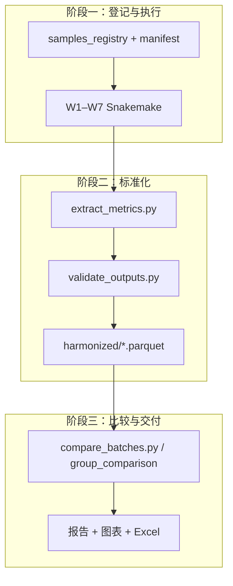
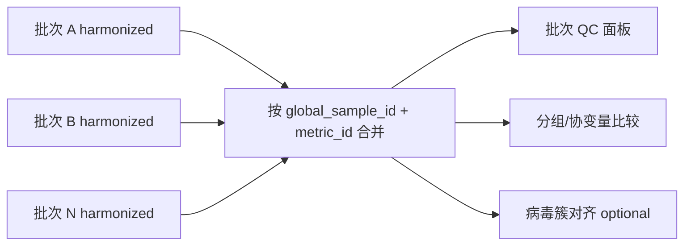

# XvirBench：面向宏转录组的跨批次统一指标框架与可比较分析体系

## 分析规划书

| 项目 | 内容 |
|------|------|
| **研究题目** | XvirBench：面向宏转录组的跨批次统一指标框架与可比较分析体系 |
| **英文题目** | XvirBench: A harmonized metrics framework for cross-batch comparative analysis of metatranscriptomes |
| **文档版本** | v1.0 |
| **编制日期** | 2026-05-30 |
| **指标字典** | [`WORKFLOW_SUMMARY.md`](WORKFLOW_SUMMARY.md) |
| **框架设计** | [`../benchmark/DESIGN.md`](../benchmark/DESIGN.md) |
| **流程规范** | [`../STANDARDS.md`](../STANDARDS.md) |
| **试点批次** | `benchmark/test/runs/pxy_V350399508`（测序 ID：V350399508） |

---

## 摘要

宏转录组测序在病毒监测、病原体发现和微生物群落研究中应用广泛，但不同项目、批次与实验设计下的生信流程输出格式各异，缺乏统一的指标空间与元数据登记规范，导致**跨队列比较困难、结果难以复现与整合**。本研究拟构建 **XvirBench** 分析体系：在既有七条 Snakemake Workflow（W1–W7）执行层之上，建立元数据登记、指标标准化抽取、harmonized 存储与比较分析四层架构，使**任意一组宏转录数据**在登记后均可映射到同一套指标维度（W1-R01…W7-F21），支撑批次间 QC、分组比较与方法学 benchmark。

本规划书以试点批次 **pxy_V350399508**（11 样本、44 测序 run、W1–W5 全流程已完成）为验证基础，说明研究背景、目标、内容、技术路线与预期成果。小鼠（rat）与文库碎片化分组仅为**首个验证场景**，不作为框架边界。

---

## 一、研究背景

### 1.1 领域现状与痛点

宏转录组（metatranscriptomics）可同时捕获宿主转录本、病毒 RNA 与细菌/真菌等微生物 RNA 信号，是 One Health 与病原监测的重要技术路线。实践中常见以下问题：

1. **流程输出碎片化**：质控 JSON、组装 FASTA、BLAST 表、Bracken 丰度、RPM 矩阵、Excel 宿主鉴定表等分散在不同目录，字段命名与粒度不统一。
2. **跨批次不可比**：不同批次的样本 ID、病毒参考序列、Kraken/CheckV 数据库版本、软件版本未系统登记；比较时往往只能做「目视对比」或手工拼表。
3. **指标语义不清**：如「病毒丰度」可能指 RPM、mapped reads 比例或 contig 数；「宿主信号」可能来自 W3 EukaMarker 或 W7 STAR 比对，缺少统一 ID。
4. **实验因素与生物信号混杂**：建库方法、测序深度、宿主物种、批次效应等未在元数据层显式建模，组间比较易得出偏倚结论。
5. **方法学评估缺乏基准**：RNA 热打断 vs cDNA 酶切等建库策略对**下游病毒/微生物检出**的影响，缺少与宿主 RNA-seq 质量指标（W7）联动的统一评估框架。

### 1.2 已有工作基础

本课题组已具备较完整的执行层与分析试点：

| 层次 | 已有成果 | 说明 |
|------|----------|------|
| **执行层** | W1–W7 共七条 Snakemake 流程 | W1 上游 → W2/W3/W4 并行 → W5/W6；W7 建库方法学 benchmark |
| **指标字典** | [`WORKFLOW_SUMMARY.md`](WORKFLOW_SUMMARY.md) | 定义 W1-R01…W7-F21 共百余项可抽取指标及来源文件 |
| **框架设计** | [`benchmark/DESIGN.md`](../benchmark/DESIGN.md) | manifest、registry、harmonized parquet、比较层架构草案 |
| **流程规范** | [`STANDARDS.md`](../STANDARDS.md) | 目录结构、Snakemake 入口、路径与配置约定 |
| **自动化运行** | `benchmark/test/run_w1_to_w5.sh` | 多样本、多 run 批次一键 W1→W5，支持断点续跑 |
| **试点批次** | `pxy_V350399508` | 11 样本 × 4 lane，W1–W5 已跑通；指标 Excel + 运行报告 + 分组比较报告 |
| **关联项目** | `vazyme/fragmentation_test` | 大样本 rat/tick 碎片化 STAR/Picard 基准，可与 W7 指标对齐 |

### 1.3 试点批次简述（验证用例，非研究边界）

**pxy_V350399508** 批次用于验证 XvirBench 从「原始 FASTQ → 流程执行 → 指标抽取 → 分组比较」的闭环：

- **规模**：44 测序 run → 11 生物学样本（`sampleinfo.txt`）
- **分组变量**：`groupinfo.txt` 第 4 列 `library_method`（三种碎片化处理：cDNA 30°C 5min、RNA 85°C 6min、RNA 94°C 7min）
- **流程完成度**：W1–W5 全部完成（2026-05-27 至 05-29）
- **已产出**：
  - 运行与结果报告：`reports/pxy_V350399508_生信运行与结果分析报告.md`
  - 指标汇总 Excel：`reports/pxy_V350399508_benchmark_metrics.xlsx`（19+ 工作表）
  - 分组比较：`reports/group_comparison/`（统计检验 + PDF 图）
- **已知 QC 问题**：v73、v88 合并后 reads < 5M，已标记为低深度；框架需内置深度可比性规则（见 DESIGN §5.1）

该批次证明：**在统一指标定义下，可按任意分组变量（此处为建库方法）对 W1–W5 指标做组间比较**；框架推广至其他宿主、其他分组（时间点、地点、处理组）时仅需更换 registry 中的 `group` 列，无需改流程规则。

---

## 二、研究目标与意义

### 2.1 总体目标

构建 **XvirBench** 跨批次一体化分析体系，实现：

> **任意宏转录组批次在元数据登记与流程执行后，均可被抽取到同一指标空间，并在统一维度下进行 QC、分组比较与跨批次整合分析。**

### 2.2 具体目标

| 编号 | 目标 | 可验收标准 |
|------|------|------------|
| **G1** | 建立指标字典与数据模型 | 覆盖 W1–W7 全部 metric_id；harmonized 长表/宽表 schema 定稿并入库 |
| **G2** | 建立元数据登记规范 | 每批次具备 `manifest.yaml` + `samples_registry.tsv`；含 batch/group/method/数据库版本 |
| **G3** | 实现指标自动抽取 | `extract_metrics.py` 对试点批次抽取成功率 >95%；`validate_outputs.py` 通过 |
| **G4** | 实现比较分析模块 | 支持组内/组间比较、批次间 QC 面板、低深度/异常样本 flag |
| **G5** | 完成试点验证 | pxy 批次指标表、分组比较报告、图表模板可一键再生 |
| **G6** | 扩展第二批次 | 至少再接入 1 个批次，演示跨批次 `compare_batches.py` |
| **G7**（可选） | 病毒跨批次对齐 | `build_virus_cluster_map.py` + 统一参考策略 B 试点 |

### 2.3 科学意义

1. **方法学**：为宏转录组病毒/微生物分析提供可复用的「指标—流程—文件」映射标准，降低跨项目整合成本。
2. **应用**：支撑病原监测、暴发调查、建库方案选型（W7）等多场景在同一尺度下的比较。
3. **可重复性**：manifest 锁定软件与数据库版本，指标带 `source_file` 与 `extracted_at`，满足审计与复现要求。

### 2.4 应用价值

- **实验室内部**：新批次上线后自动进入同一 QC 看板，与历史批次对比深度、病毒检出与微生物背景。
- **多中心协作**：通过 `global_sample_id` 与统一 metric_id 合并队列，避免手工拼表错误。
- **产品/服务交付**：标准化 Excel/Parquet 报告模板，缩短从测序到解读周期。

---

## 三、研究内容

研究内容分为 **五个模块**，与 XvirBench 架构一一对应。

### 3.1 模块 A：指标字典与可比性规则（理论层）

**依据**：[`WORKFLOW_SUMMARY.md`](WORKFLOW_SUMMARY.md)

- 维护 W1–W7 全部可获取指标的定义：指标 ID、名称、粒度（run/sample/contig/taxon）、来源文件、字段路径、单位。
- 定义**跨流程最小指标集**（测序深度、组装规模、病毒鉴定、病毒丰度、微生物背景、宿主背景、注释质量、建库方法学，见 WORKFLOW_SUMMARY §跨流程核心衔接指标）。
- 制定**可比性规则**（DESIGN §5）：
  - 深度：RPM 分母、保留率、极差比 flag
  - 微生物：同一 Kraken 库版本；丰度用 fraction 或 CLR
  - 病毒：策略 A（簇级比较）vs 策略 B（统一参考重比对）
  - W7：同一宿主参考 FASTA+GTF 版本

**产出**：`benchmark/schema/metrics_schema.yaml`（指标 ID → 列定义、类型、单位）。

### 3.2 模块 B：元数据与批次登记（登记层）

**依据**：DESIGN §4

- **`samples_registry.tsv`**：全局样本 ID、批次 ID、本地样本 ID、分组（`group`）、建库方法（`library_method`）、run 列表、原始 FASTQ 路径等。
- **`manifest.yaml`**：测序平台、读长、各 workflow 输出目录、数据库路径、软件版本、病毒定量参考策略。
- **分组语义**：`group` 为通用实验分组；`library_method` 专用于 W7/建库比较；同一批次可有多个比较维度（pxy 试点用 `groupinfo.txt` 的 method 列）。

**试点映射示例**：

```
groupinfo 样本 61 → global_sample_id: pxy_V350399508__v61
                  → library_method: cDNA_Frag_30C5Min
```

### 3.3 模块 C：流程执行与质量控制（执行层）

**依据**：W1–W7 Snakemake 流程 + `run_w1_to_w5.sh`

- 标准分析链：**W1 →（W2 ∥ W3 ∥ W4）→ W5 →（W6）**；W7 按项目需要并行。
- 批次目录规范：`benchmark/batches/{batch_id}/outputs/workflow*/` 或当前试点路径 `benchmark/test/runs/{batch_id}/`。
- QC 门禁：深度、Q30、保留率、W5 与 W1 clean reads 一致性、低深度 flag。

**pxy 试点已验证**：全流程自动化、断点续跑（`--from-w2` / `--from-w4`）、典型故障修复清单（taxonkit、Bracken combine、mkdir parents 等）已沉淀至运行报告。

### 3.4 模块 D：指标抽取与 harmonized 存储（标准化层）

**依据**：DESIGN §6–§7

实现并完善：

| 脚本 | 功能 |
|------|------|
| `extract_metrics.py` | 读 manifest + registry，从各 workflow 输出抽取 metric_id，写入 harmonized |
| `validate_outputs.py` | 输出完整性、必填指标非空率、深度一致性 |
| `normalize_bracken.py` | Bracken 长表化、物种/属/科层级统一 |
| `build_virus_cluster_map.py` | 跨样本/跨批次病毒 contig 簇映射 |

**Harmonized 主题表**（Parquet）：

- `qc_upstream.parquet`
- `virus_identification.parquet`
- `virus_quantification_rpm.parquet`
- `microbiome_bracken.parquet`
- `host_identification.parquet`
- `virus_annotation.parquet`（W6 启用时）
- `fragmentation_benchmark.parquet`（W7 启用时）

**试点过渡方案**（已部分实现）：`build_benchmark_report.py` + Excel 多 sheet → 后续迁移为 parquet 长表。

### 3.5 模块 E：比较分析与报告（比较层）

**依据**：DESIGN §8 + pxy `group_comparison_analysis.py` 试点

- **组内/组间比较**：按 `group`、`library_method`、`batch_id` 等变量分组；Kruskal-Wallis + Mann-Whitney（BH）；描述统计 mean±SD / median。
- **批次间比较**：多批次 harmonized 表 join；QC 面板（深度、未分类比例、病毒 contig 数分布）。
- **可视化**：按模块分面箱线图（W1 深度/组装、W2 病毒、W4 微生物、W5 RPM、W7 宿主比对等）；低深度样本标注。
- **报告模板**：批次运行报告、分组比较报告、跨批次综合报告（Markdown + Excel + PDF 图）。

**比较配置示例**（`comparisons/{id}/config.yaml`）：

```yaml
comparison_id: "pxy_fragmentation_w1w5"
batches: ["pxy_V350399508"]
group_by: "library_method"
metrics: ["W1-R18", "W1-S05", "W2-V01", "W4-K01", "W5-Q08"]
exclude_flags: ["low_depth"]
tests: ["kruskal_wallis", "mannwhitney_bh"]
```

---

## 四、技术路线

### 4.1 总体架构



**设计原则**：执行与比较解耦；比较层只读 workflow 输出，不修改 Snakemake 规则（DESIGN §1.3）。

### 4.2 数据流（单批次）

```
原始 FASTQ + 样本表/分组表
    ↓ 登记 manifest + registry
W1 fastp → 去 rRNA → 合并 → 组装
    ↓                    ↓
clean reads + contigs   W1 指标 (W1-R*, W1-S*)
    ↓
W2 病毒鉴定 ∥ W3 宿主鉴定 ∥ W4 Kraken/Bracken
    ↓
W5 病毒 RPM 定量（参考 = 本批次 W2 putative_viralcontigs）
    ↓（可选 W6 注释、W7 建库 benchmark）
extract_metrics.py → harmonized 表
    ↓
compare / group_comparison → 统计 + 图 + 报告
```

### 4.3 指标抽取路线（按 Workflow）

| Workflow | 核心抽取指标（metric_id 示例） | 试点 pxy 状态 |
|----------|-------------------------------|---------------|
| W1 | W1-R01–R19（run QC）；W1-S01–S08（sample 组装） | ✅ 已入 Excel |
| W2 | W2-V01–V12（病毒 contig、CheckV、聚类） | ✅ 已入 Excel |
| W3 | W3-H01–H06（宿主物种、标记基因） | ✅ 已入 Excel |
| W4 | W4-K01–K08（Kraken 未分类、Bracken 丰度） | ✅ 已入 Excel |
| W5 | W5-Q01–Q10（RPM、coverage、mapping rate） | ✅ 已入 Excel |
| W6 | W6-A01–A08（注释、一致性） | ⏸ 未运行 |
| W7 | W7-F01–F14（宿主比对、偏倚、重复、嵌合） | ⏸ 本批次未运行；vazyme 项目可对接 |

### 4.4 跨批次比较路线



**病毒丰度跨批次**：默认策略 A（簇级比较）；需严格 RPM 可比时启用策略 B（统一 `viral_ref_v*` 重跑 W5）。

### 4.5 软件与环境

| 用途 | 路径/环境 |
|------|-----------|
| W1–W6 主环境 | `/data/user/guojindan/softwares/xvirmin` |
| W7 建库 benchmark | `micromamba_root/envs/metatrans_compare` |
| 流程编排 | Snakemake（`--scheduler greedy`） |
| 抽取/比较 | Python 3.10+（pandas, pyarrow, scipy） |
| 可视化 | R base（箱线图）；可选 matplotlib |
| 存储格式 | Parquet（分析）、Excel（交付）、Markdown（报告） |

### 4.6 实施阶段与里程碑

| 阶段 | 时间（建议） | 任务 | 交付物 |
|------|--------------|------|--------|
| **P0 已完成** | 2026-05 | W1–W5 试点跑通；指标字典；DESIGN 草案；pxy 报告与分组比较 | 本规划书所列试点产出 |
| **P1** | +2 周 | 定稿 `metrics_schema.yaml`；pxy 迁入 `batches/pxy_V350399508/` 标准目录；manifest/registry | 标准批次目录 + 元数据 |
| **P2** | +4 周 | `extract_metrics.py` + `validate_outputs.py`；pxy → harmonized parquet | 7 类 parquet + 校验报告 |
| **P3** | +3 周 | 泛化 `compare_batches.py`；合并 group_comparison 逻辑；报告模板 | 比较配置 + 模板化报告 |
| **P4** | +4 周 | 接入第二批次；跨批次 QC 面板；文档与示例 notebook | 跨批次比较案例 |
| **P5**（可选） | +4 周 | W6 接入；W7 与 vazyme 指标合并；病毒簇对齐策略 B | 方法学扩展报告 |

---

## 五、试点批次分析基础（pxy_V350399508）

本节记录已完成的分析成果，作为 XvirBench 实施的**基线参考**。

### 5.1 数据与分组

| 项目 | 内容 |
|------|------|
| 批次 ID | `pxy_V350399508` |
| 测序 run | 44（11 样本 × 4 lane） |
| 宿主 | rat（示例宿主，框架不限宿主） |
| 比较变量 | `library_method`：cDNA_Frag_30C5Min（n=4）、RNA_Frag_85C6Min（n=4）、RNA_Frag_94C7Min（n=3） |
| 低深度 | v73、v88（合并 R1 < 5M reads） |

### 5.2 关键结果摘要

| 维度 | 结果要点 |
|------|----------|
| **W1 质控** | fastp 后 Q30 中位 ~93%；多数样本合并 R1 12–24M reads |
| **W1 组装** | ≥1kb contig 约 2.2万–9.7万/样本（低深度样本仅 ~1.8k） |
| **W2 病毒** | 71 条假定病毒 contig；12 个 ANI80 聚类；13 条 CheckV High-quality |
| **W4 微生物** | Kraken 未分类 83–95%；Bracken 物种数 11–53/样本 |
| **W5 定量** | RPM 表 540 行；跨样本共享病毒 contig 可见高 RPM 信号 |
| **组间比较** | 全样本下 KW 检验无 p<0.05；排除低深度后 contig 数 KW p≈0.03 |

### 5.3 已沉淀脚本与文档

| 路径 | 用途 |
|------|------|
| `benchmark/test/run_w1_to_w5.sh` | 批次自动化执行 |
| `reports/build_benchmark_report.py` | 指标抽取 → Excel + 运行报告 |
| `reports/group_comparison_analysis.py` | 按 groupinfo 分组比较 + R 绘图 |
| `reports/pxy_V350399508_benchmark_metrics.xlsx` | 指标交付表 |
| `reports/group_comparison/GROUP_COMPARISON_REPORT.md` | 分组比较结论 |

### 5.4 从试点到框架的迁移清单

- [ ] 将 `sampleinfo.txt` / `groupinfo.txt` 映射为 `samples_registry.tsv` 标准列
- [ ] 为 pxy 编写 `manifest.yaml`（数据库版本、输出路径、完成时间）
- [ ] `build_benchmark_report.py` 逻辑并入 `extract_metrics.py`
- [ ] Excel sheet 与 harmonized parquet 列名对齐 metric_id
- [ ] `group_comparison_analysis.py` 改为读取 harmonized 表 + comparison config

---

## 六、预期成果

### 6.1 理论与规范成果

1. **指标字典**（持续维护）：[`WORKFLOW_SUMMARY.md`](WORKFLOW_SUMMARY.md)
2. **框架设计文档**：[`benchmark/DESIGN.md`](../benchmark/DESIGN.md)（由 Draft → v1.0）
3. **本分析规划书**：[`XVIRBENCH_ANALYSIS_PLAN.md`](XVIRBENCH_ANALYSIS_PLAN.md)
4. **指标 schema**：`benchmark/schema/metrics_schema.yaml`

### 6.2 软件与流程成果

| 类型 | 名称 | 说明 |
|------|------|------|
| 流程 | W1–W7 | 已有；按 STANDARDS 维护 |
| 脚本 | `extract_metrics.py` | 指标抽取主入口 |
| 脚本 | `validate_outputs.py` | 批次校验 |
| 脚本 | `compare_batches.py` | 跨批次/跨分组比较 |
| 脚本 | `run_w1_to_w5.sh` | 批次执行封装（可推广为 `run_batch.sh`） |
| 配置 | `comparisons/*/config.yaml` | 可复现比较实验定义 |

### 6.3 数据成果

| 类型 | 说明 |
|------|------|
| `harmonized/*.parquet` | 机器可读标准指标表 |
| 批次 Excel 报告 | 面向交付的多 sheet 汇总（试点已有模板） |
| QC flag 表 | 低深度、保留率异常、比对异常等 |

### 6.4 分析报告成果

| 报告 | 内容 |
|------|------|
| 批次运行报告 | 流程状态、时间线、故障与修复、输出索引 |
| 分组/组间比较报告 | 描述统计、假设检验、图表、结论 |
| 跨批次综合报告 | 多批次 QC 与趋势（P4 后） |
| 方法学扩展报告 | W7 + W1–W5 联合解读（可选） |

### 6.5 论文/汇报产出（可选）

- 方法短文：XvirBench 指标框架与 harmonized 模型
- 应用案例：多批次宏转录组病毒监测数据的整合分析
- 方法学案例：建库碎片化对病毒/微生物检出影响的统一尺度评估（需补齐 W7 与同批次 W1–W5 联动）

---

## 七、风险评估与对策

| 风险 | 影响 | 对策 |
|------|------|------|
| 测序深度批次间差异大 | RPM/Bracken 不可比 | 深度 flag；报告保留率与绝对 reads；必要时 subsample |
| 数据库版本不一致 | Kraken/CheckV/NT 结果漂移 | manifest 强制登记；跨批次比较前版本校验 |
| 病毒 contig ID 跨批次不一致 | RPM 无法直接拼表 | 策略 A 簇级比较；策略 B 统一参考 |
| 小样本组间检验功效低 | 假阴性/假阳性 | 报告效应量与置信区间；强调探索性；扩大样本 |
| 低质量文库混入 | 拉低组均值或引入假信号 | QC 门禁 + 敏感性分析（含/不含 flagged 样本） |
| 流程版本迭代 | 历史批次指标不可比 | manifest 记录 git commit / config 快照 |

---

## 八、与关联文档的索引

| 文档 | 路径 | 关系 |
|------|------|------|
| 指标方案（字典） | [`WORKFLOW_SUMMARY.md`](WORKFLOW_SUMMARY.md) | 本规划核心依据 |
| 框架设计 | [`../benchmark/DESIGN.md`](../benchmark/DESIGN.md) | 架构与数据模型 |
| 流程规范 | [`../STANDARDS.md`](../STANDARDS.md) | 执行层约定 |
| 建库 benchmark 方案 | [`../benchmark/metatranscriptomics-rna-vs-cdna-fragmentation-benchmark.md`](../benchmark/metatranscriptomics-rna-vs-cdna-fragmentation-benchmark.md) | W7 科学设计 |
| 试点运行报告 | [`../benchmark/test/runs/pxy_V350399508/reports/pxy_V350399508_生信运行与结果分析报告.md`](../benchmark/test/runs/pxy_V350399508/reports/pxy_V350399508_生信运行与结果分析报告.md) | 验证基线 |
| 试点分组比较 | [`../benchmark/test/runs/pxy_V350399508/reports/group_comparison/GROUP_COMPARISON_REPORT.md`](../benchmark/test/runs/pxy_V350399508/reports/group_comparison/GROUP_COMPARISON_REPORT.md) | 比较层试点 |
| vazyme 大样本基准 | `Projects/vazyme/fragmentation_test/analysis/rat/BENCHMARK_REPORT.md` | W7 扩展验证 |

---

## 九、结语

XvirBench 的核心价值不在于完成某一个宿主或某一次测序实验的分析，而在于建立**「登记 → 执行 → 抽取 → 比较」**的可复制范式，使任意宏转录组数据进入体系后都能在**同一指标维度**上对话。试点批次 pxy_V350399508 已验证执行层与分析层的可行性；后续工作重心将转向 harmonized 存储、自动抽取与跨批次比较模块的产品化，并接入更多批次以检验框架的通用性与扩展性。

---

*文档结束*
